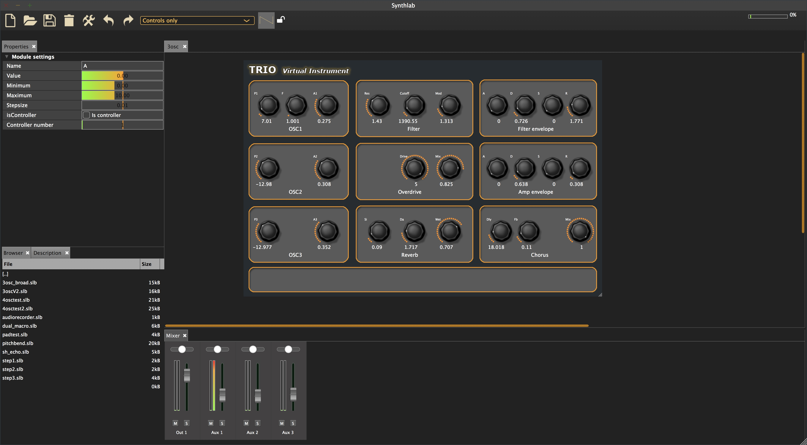
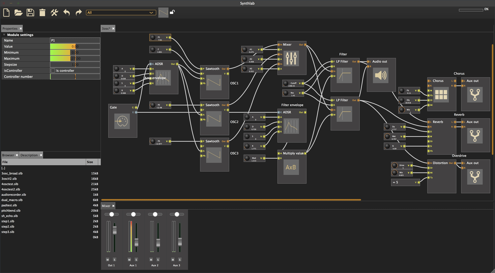
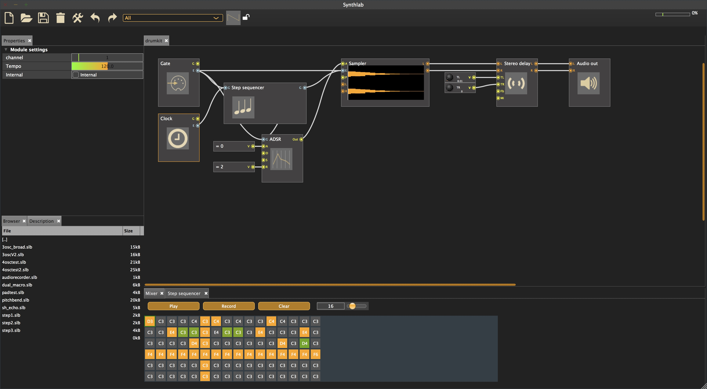
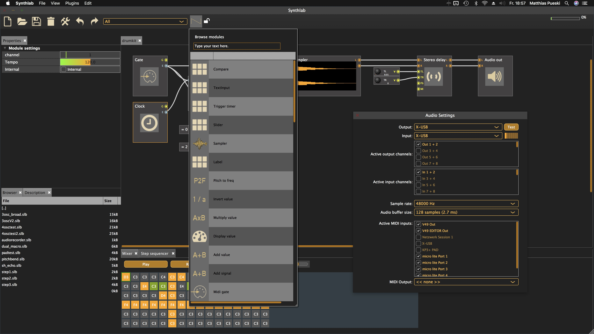
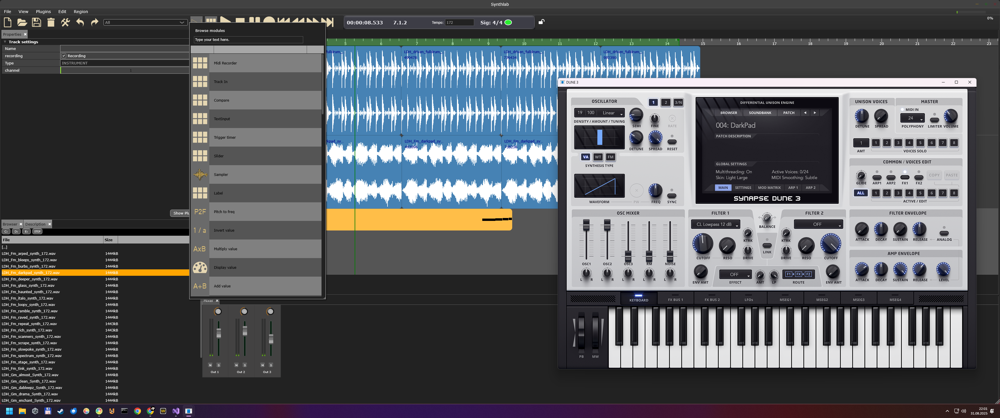
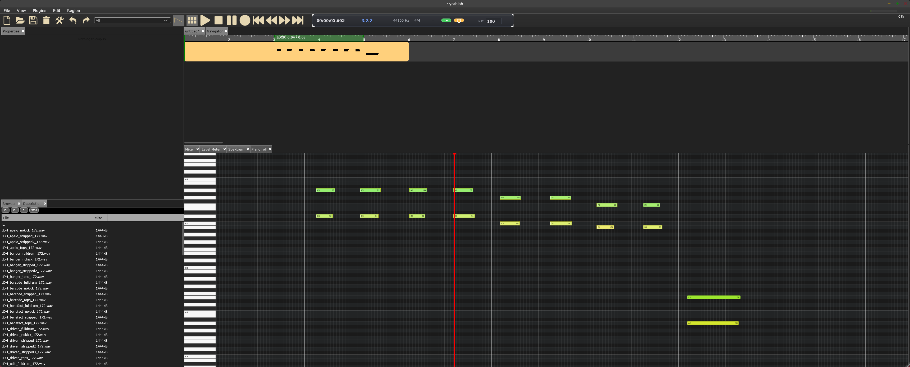
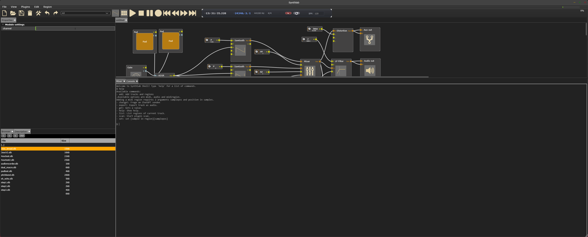

# Project Status (February 2026)

After 466 commits and years of work, I'm archiving this project.

**What I learned:**
- JUCE framework mastery
- Complex audio engine architecture
- VST3 hosting
- Multi-platform audio development

**Why I'm stopping:**
- The scope became too large for a solo project
- I've moved on to other interests (cflux, AI-assisted development)
- Synthlab was an incredible learning journey, but it's time to let it rest

**For anyone interested:**
- The code is here, feel free to fork
- Contact me if you want to continue it
- I'm proud of what I built, even if it's not "finished"

Thanks to everyone who starred this project. ❤️

Original tetx below:

# Synthlab
Modular Synthesizer Studio

Synthlab is a modular DAW. It allows you to build yor own DAW and synthesisers in a graphical manner. 

Currenly Synthlab is intended as a standalone application. I'll probably provide a plugin in the future.

Here's how it looks like:

Synthlab allows complex structures, macros, nesting and much more:

 

Countless variations are possible, so you can end up with a simple sampler, incredible synths and grooveboxes as well:

 

Synthlab provides a convenient module browser, many user controls and sound modules.

 

As mentioned Above it has DAW capabilities,currently it is working on a basical Level, but I am still heavily improving. As you can see I can load and use VST3 Plugins  (yeah!)

 

There's a piano roll Editor as well:

 

And theres a console, just in case: ;)

 

It currently runs on:

* Windows
* macOS
* iOS

It should also run on Linux and Android, but this has not been tested yet.

It's a JUCE project, so simply go to juce.com and download the framework. 
Then start the projucer and open the project file in order to generate your platform configuration.

# Notice
This is a project at a very early stage but works already good. I currently neither has any docs or tutorials or something.
To get the thing running you can use the projucer. But if you would like to have support you're probably alone an your way.

The samples folder contains a few simple samples though.

But do not hesitate to dig into the code and make Synthlab a better place. ;)

Feel free to contact me for questions.

