# Synthlab Manual

Draft 

Matthias Püski (June 2026)
---

## Table of Contents

1. [Getting Started](#1-getting-started)
2. [Settings](#2-settings)
3. [General Settings](#3-general-settings)
4. [Mixer](#4-mixer)
5. [Piano Roll](#5-piano-roll)
6. [Record Arming Tracks](#6-record-arming-tracks)
7. [Track Navigator](#7-track-navigator)
8. [Track Properties](#8-track-properties)
9. [Regions](#9-regions)
10. [Duplicating Regions](#10-duplicating-regions)
11. [Signal Structure](#11-signal-structure)
12. [Building Instruments](#12-building-instruments-and-usefull-stuff)

**Appendix**

- [A. Lupo Synthesizer](#a-lupo-synthesizer)
- [B. SA-1 Drum Sampler](#b-sa-1-drum-sampler)
- [C. Instrument Plugins](#c-instrument-plugins)
- [D. Effect Plugins](#d-effect-plugins)
- [E. Module Reference](#e-module-reference)
- [F. JavaScript API](#f-javascript-api)

---

## 1. Getting Started

When you first launch Synthlab, you are greeted with the main application window. The interface is divided into several areas: the toolbar at the top, the Editor in the center, panels for the Browser, Properties, and Instruments on the sides, and the tool panel at the bottom which provides access to the Mixer, Level Meter, Spectrum analyzer, and Piano Roll.


You may drag and reorder the window layout at any time, it will be saved automatically and will be restored the next time you start Synthlab.

A populated session shows how these areas work together — the arrangement with its audio and MIDI regions in the centre, the Mixer docked at the bottom, and (here) the JavaScript Editor docked on the right:

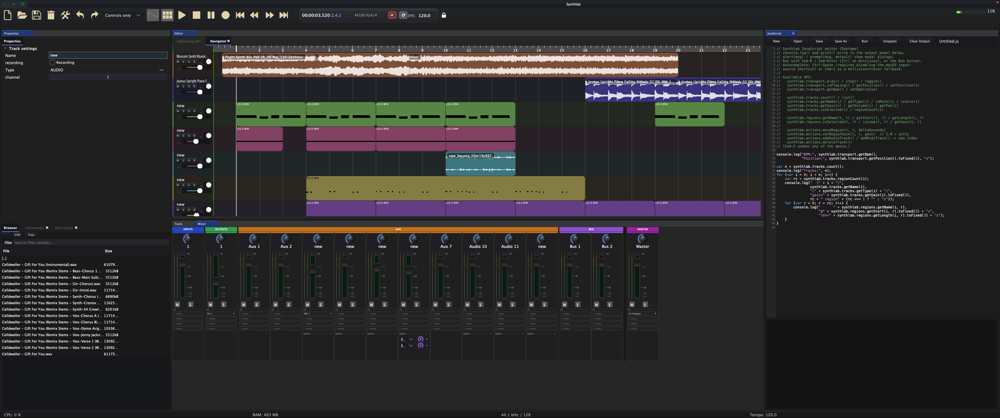

---

## 2. Settings

The Settings dialog gives you access to all global application preferences, including audio device configuration, MIDI setup, and behavior options.


---

## 3. General Settings

The General settings tab contains options that affect the overall behavior of Synthlab, such as default tempo, project path, and UI preferences.


---

## 4. Mixer

The Mixer is accessible via the bottom panel. It displays all active tracks as individual channel strips, each with a volume fader, a pan knob, Mute (**M**) and Solo (**S**) buttons, FX insert slots, and a Sends section for routing to auxiliary buses.

Channels are grouped into **INPUTS**, **OUTPUTS**, **AUX** outs, **AUDIO** outs, **BUS** outs and a **MASTER** channel on the far right. The colored LED meters on each strip show real-time signal levels.


### Inserts and Busses

Below the fader, each strip has an **FX** section with several insert slots. Click an empty slot (`- empty -`) to load an effect plugin (see [Effect Plugins](#d-effect-plugins)); the loaded plugin's name is shown in the slot, and the **E** button next to it opens the plugin's editor. Inserts are processed top to bottom.

Underneath the inserts is the **SENDS** section. Click the **+** to add a send and route a copy of the channel's signal — at an adjustable send level — to a **BUS** or **AUX** channel. This is the standard way to share one reverb or delay across several tracks, or to build sub-mix groups. In the example below, two channels carry inserts (DL-1, SW-1 and a Co-Producer plugin) and one channel sends to two busses:

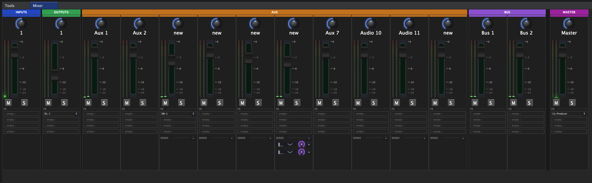

---

## 5. Piano Roll

The Piano Roll editor opens in the bottom panel and allows you to draw, edit, and arrange MIDI notes. The toolbar at the top provides tools for **Select**, **Pencil**, **Eraser**, **Velocity**, and **Split**, as well as controls for the grid resolution, scale, snap, note display, and patterns.

The Piano Roll Editor provides the following shortcuts:

| Shortcut    |  Function        |
| -------     | -----------------|
| CMD + A     | Select all notes |
| Cursor Up   | Move selected notes up |
| Cursor Down | Move selected notes down |
| Shift + Cursor Up   | Move selected notes one octave up |
| Shift + Cursor Down | Move selected notes one octave down |
| Cursor Left   | Move selected notes to the left on the raster |
| Cursor Right  | Move selected notes to the right on the raster |
| Shift + Cursor Left   | Shortens selected notes to the left on the raster |
| Shift + Cursor Right  | Lengthens  selected notes to the right on the raster |


The keyboard on the left side of the roll indicates pitch. Notes are displayed as horizontal bars in the grid; their horizontal position represents timing and their length represents duration.

The Piano Roll shares the bottom panel with the Mixer, Level Meter, and Spectrum analyzer — click the **Piano Roll** tab to switch to it.


---

## 6. Record Arming Tracks

To record MIDI input onto a track, you must first arm it for recording. Click the **R** button on the track header. An armed track will show the **R** button highlighted in red.

In the example below, the **Lupo** track is armed and ready to record, while the **SA-1** track is not.


---


## 7. Track Navigator


The Track Nabigator gives you the ability to navigate in your composition.

In order to select a track left click in the according track lane. To resize a track just grab the track separator between the tracks and drag it with the mouse. If you'd like to resize all tracks simultaneously, hold the OPTION key while dragging.

**Tracks can currently not be reordered**

The Track Navigator responds to the following keyboard shortcuts:

| Shortcut | Function |
| -------- | -------- |
| Space    | Start / stop playback |
| +        | Zoom in (horizontal) |
| -        | Zoom out (horizontal) |

The transport shortcut (**Space**) works globally, from any panel. The zoom shortcuts require the Track Navigator to have keyboard focus — click into the timeline first.

---

## 8. Track Properties

Clicking on a trackopens the **Properties** panel on the left side of the Editor. Here you can configure:

- **Name** — the display name of the track
- **Recording** — enable or disable recording for this track
- **Type** — the track type (e.g. `INSTRUMENT`)
- **Channel** — the MIDI channel the track listens on

The **Show Plugin** button at the bottom opens the instrument plugin associated with the track.


---

## 9. Regions

A **Region** is the fundamental building block of a track in Synthlab. Each region holds MIDI note data for an instrument track (or audio data for audio tracks). Regions are displayed as colored blocks on the timeline and can be moved, resized, duplicated, or deleted.

The BPM of the project is shown in the top-left corner of each region.


Regions can be selected, moved or resized, select and move the region with the right mouse button, the right button just positions the Track marker at a new position, with the left mouse button ayou can change the selected track.


The commands for editing regions are common for MIDI and AUDIO regions:

| Shortcut    |  Function        |
| -------     | -----------------|
| CMD + C     | Copy selected region(s) to the clipboard |
| CMD + V     | Paste region(s) at the playhead into the current track |
| CMD + D     | Duplicate selected region(s) |
| CMD + X     | Cut selected region(s) (copy, then remove) |
| CMD + T     | Split selected region(s) at the marker |
| CMD + L     | Toggle loop on the selected region(s) |
| CMD + E     | Open the current MIDI region in the Piano Roll |
| CMD + M     | Open the current MIDI region in the Event Editor |
| CMD + B     | Bounce the selected region(s) in place |


There are two types of regions.

### MIDI Regions

MIDI Regions hold MIDI notes and events such as CC changes or automation data. If you double click a MIDI Region, the Piano Roll editor will be opened. Selecting a MIDI region shows its **Name** and **Length** in the Properties panel.


### Audio Regions

Audio Regions hold audio data and can be moved and resized the same way MIDI regions do. In addition to **Name** and **Length**, the Properties panel for an audio region exposes:

- **Pitch (semitones)** — transpose the audio up or down
- **Reference Tempo (BPM)** — the tempo the audio was recorded at
- **Follow Tempo** — when enabled, the region is time-stretched to follow the project tempo
- **Gain** — playback level of the region


---

## 10. Duplicating Regions

You can duplicate a MIDI region to fill a timeline quickly. Select a region and use the duplicate command to create multiple consecutive copies. The duplicated regions will appear back-to-back across the timeline, each inheriting the original's content and tempo information.


---

## 11. Signal Structure

The **Structure** view (accessible via the Editor tabs) shows the internal signal routing of your project as a node graph. Each track row consists of:

- **Gate** — controls when the track is actives
- **Track In** — receives the MIDI or audio input
- **Plugin** — the instrument or effect assigned to the track
- **Aux** — the output bus the track is routed to

This view is useful for understanding and customizing the signal flow of complex projects.


---

## 12. Building Instruments and Useful Stuff

As you might have guessed, you can also build your own instruments with Synthlab in a convenient way. For this, Synthlab provides over 80 modules. We will not be discussing each module here in detail; if you want to know what each module does, see the appendix for reference.

### Basics

Every instrument in Synthlab is a **patch** — a graph of modules wired together. The same patch can be viewed two ways: as a clean front panel of controls, and as the underlying node graph.

Consider the following front panel of a patch:


The patch behind this panel looks like this:


This patch contains most of the conceptual things of Synthlab you need to know.

You can switch the editor between **Controls only** (front panel) and the full graph using the view selector in the toolbar. The "Controls only" view of a three-oscillator instrument together with its mixer looks like this:


…and the corresponding full module graph:


### Adding Modules

New modules are added from the **Browse modules** menu. Press **Shift + A** (or right-click the canvas) to open it, type to filter the list, and click a module to drop it onto the canvas.


### A Drum Patch

Modules are not limited to synthesizers. The patch below drives a **Sampler** from a **Step sequencer** and an **ADSR**, through a stereo delay to the audio out — a complete drum machine built from modules:


### The Console

Synthlab includes a built-in console for driving the application with text commands. Type `help` for a list of available commands — from here you can add tracks and regions, manage MIDI and audio, add or delete modules, and inspect the current track.


### Patch Editor Shortcuts

When the instrument editor (Structure / patch view) has focus, the following shortcuts are available:

| Shortcut           | Function |
| ------------------ | -------- |
| Shift + A          | Open the **Browse modules** menu at the mouse position |
| Ctrl + A           | Select all modules |
| CMD + D            | Duplicate the selected module(s) |
| Alt + D            | Duplicate the selected module(s) |
| Delete / Backspace | Delete the selected modules and connections |
| CMD + N            | New patch |
| CMD + S            | Save |
| CMD + Shift + S    | Save As… |
| CMD + L            | Load |

### Playing with the Computer Keyboard

You can play the instrument on the currently selected track straight from your computer keyboard. The keys are laid out like a piano — the lower letter row plays the white keys and the upper row the black keys:

| Key | Note | Key | Note |
| --- | ---- | --- | ---- |
| A   | C    | E   | D♯   |
| S   | D    | T   | F♯   |
| D   | E    | Z   | G♯   |
| F   | F    | U   | A♯   |
| G   | G    | O   | C♯ (next octave) |
| H   | A    |     |      |
| J   | B    |     |      |
| K   | C (next octave) | | |

Use **X** to shift the keyboard one octave up and **Y** to shift it one octave down. **L** cycles the active editor layer.


# Appendix — Plugins, Effects and Modules

## A. Lupo Synthesizer

**Lupo** is Synthlab's built-in polyphonic synthesizer. It features four oscillators, each with controls for **Pitch**, **Fine**, **Width**, **Spread**, and **Shape** (waveform selector with options including Sawtooth, and more). A **sync** option is available on Osc 2.

The central section includes:

- **Mixer** — four channels (Ch 1–4) each with **Vol** and **Pan** knobs
- **Amplifier** — ADSR envelope (**Attack**, **Decay**, **Sustain**, **Release**) and a **Main volume** knob
- **Filter 1 & 2** — each with **Cutoff**, **Q**, **Env. Amount**, **Filter Mode** (e.g. LP), and **Character** selector. A **Cutoff link** option and **Filter mode** (Serial/Parallel) are also available.
- **Filter Env.** — a dedicated ADSR envelope for filter modulation

The right panel provides tabbed access to:
- **FX** — Reverb (Room size, Damping, Width, Dry/Wet, Freeze), Stereo Delay (Time L/R, Feedback, Mix), Portamento (Intensity, Duration), Chorus (Delay, Modulation, Feedback, Mix), and Overdrive (Drive, Mix, clipping mode)
- **EQ**
- **Sequencer**
- **Arpeggiator** — with Chord, Create, and Auto modes, plus root note and scale selectors
- **Mod Matrix**
- **Modulation**

Presets can be saved and recalled using the **Presets** dropdown at the top.


---

## B. SA-1 Drum Sampler

**SA-1** is Synthlab's drum sampler, designed for building drum kits from individual samples. It features 16 pads arranged in a 4×4 grid, each assignable to a drum hit:

| Pad | Label | Pad | Label |
|-----|-------|-----|-------|
| 01  | KICK  | 02  | SNARE |
| 03  | CLAP  | 04  | RIM   |
| 05  | CH    | 06  | OH    |
| 07  | RIDE  | 08  | CRASH |
| 09  | TOM L | 10  | TOM M |
| 11  | TOM H | 12  | COWBL |
| 13  | SHKR  | 14  | TAMB  |
| 15  | PERC  | 16  | FX    |

The waveform of the currently selected pad is displayed at the top of the window, along with metadata such as duration, sample count, sample rate, and number of channels. The MIDI note assigned to the pad is shown in the top-right corner.

Each pad can be configured individually in the right panel:

- **Volume**, **Pan**, **Pitch**, **Fine** — basic level and tuning
- **Attack**, **Release** — envelope shaping
- **Start** — sets the sample start offset
- **MASTER** — overall output volume for the sampler

Additional pad options include **Reverse** (plays the sample backwards), **Choke** (mutes other pads in the same choke group), **Load Sample** (browse for a sample file), and **Clear** (removes the assigned sample).

Kits can be saved and recalled using the **Presets** dropdown at the top.


---

## C. Instrument Plugins

In addition to **Lupo** and the **SA-1**, Synthlab ships with a family of dedicated instrument plugins. Each can be assigned to an instrument track and opened with the **Show Plugin** button (see [Track Properties](#8-track-properties)), or hosted inside a patch through the **Plugin** module. All of them are MIDI-driven and come with a library of factory presets.

### PM-1 — Pad Synthesizer

**Type:** Instrument — pad / texture synthesizer

PM-1 is a polyphonic pad and texture synthesizer aimed at evolving, lush sounds, with factory presets such as Warm Pad, Bright Pad, Strings, Choir, Glass and Air. Its macro-style controls — **Texture**, **Warmth**, **Brightness**, **Movement**, **Lushness**, **Space**, **Delay**, **Width**, **Drive**, **Attack**, **Release**, **Volume**, **Octave**, **Character** and **LFO Rate** — make it easy to dial in atmospheric beds and cinematic pads.

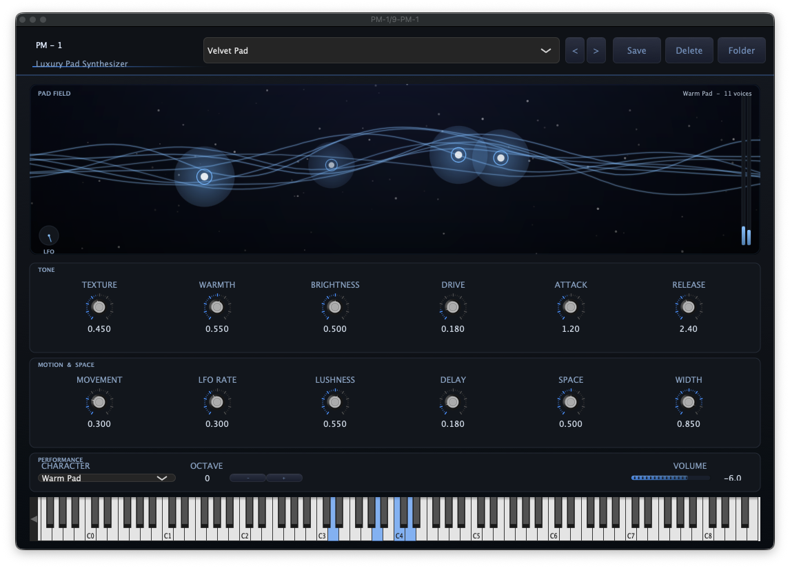

### GS-1 — Granular Synthesizer

**Type:** Instrument — granular synthesizer

GS-1 builds sounds from streams of grains, with sources such as Vocal, Strings, Choir, Bell, Glass and Air. Key controls are **Source**, **Position**, **Spray**, **Grain Size**, **Density**, **Pitch**, **Pitch Spray**, **Reverse**, **Pan Spread** and **Movement**, alongside **Attack/Release**, **Tone**, **Drive**, **Lushness**, **Space**, **Width**, **Volume**, **Octave** and **LFO Rate**. It excels at clouds, textures and evolving granular pads.

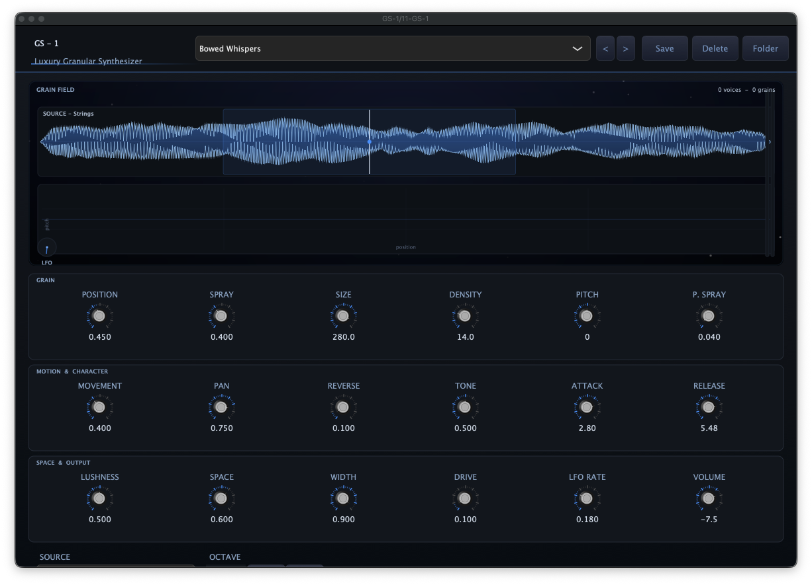

### BS-1 — Bass Synthesizer

**Type:** Instrument — monophonic bass synthesizer

BS-1 is a classic subtractive bass synth with oscillators, a sub layer and a noise source feeding a resonant filter. Controls include **Tone**, **Drive**, **Sub**, **Noise**, **Octave**, **Cutoff**, **Resonance**, **Env Amount**, filter **Decay**, amp **Attack/Sustain/Release**, **Glide**, **Warmth** and **Output**, with an on-board audition keyboard. It is tuned for punchy basslines and 303-style mono leads.

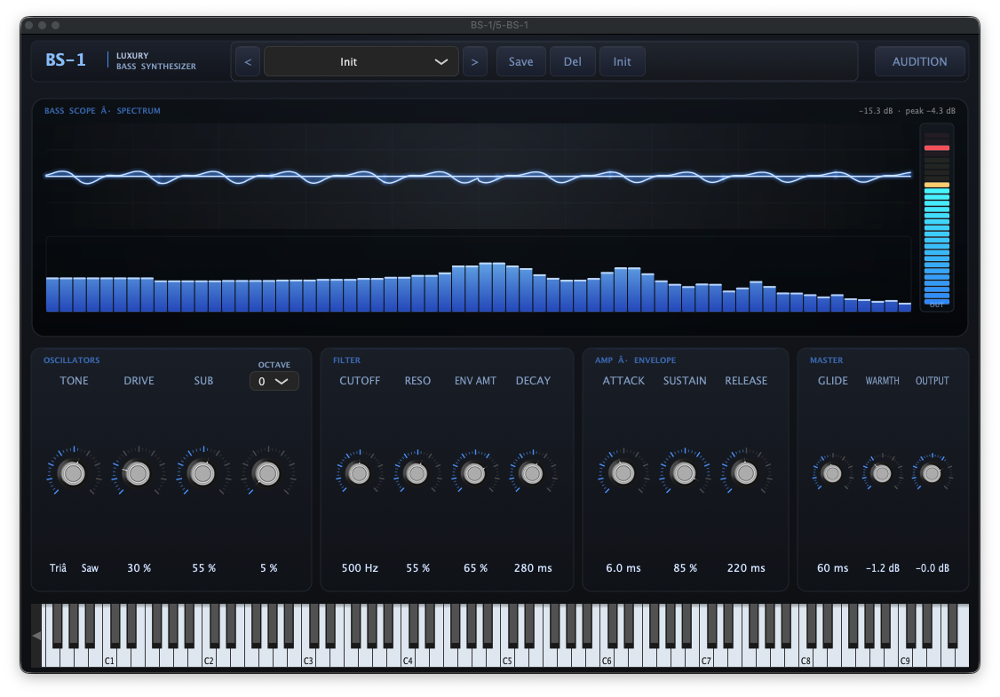

### KM-1 — Kick Machine

**Type:** Instrument — kick-drum synthesizer

KM-1 is a dedicated kick-drum synth with a pitch-enveloped body and a transient click layer. Controls are **Tune**, **Pitch Amt**, **Pitch Time**, **Body Decay**, **Click Level**, **Click Tone**, **Drive**, **Punch**, **Tone** and **Output**, with an audition button. It covers everything from deep sub kicks to punchy, clicky electronic kicks.

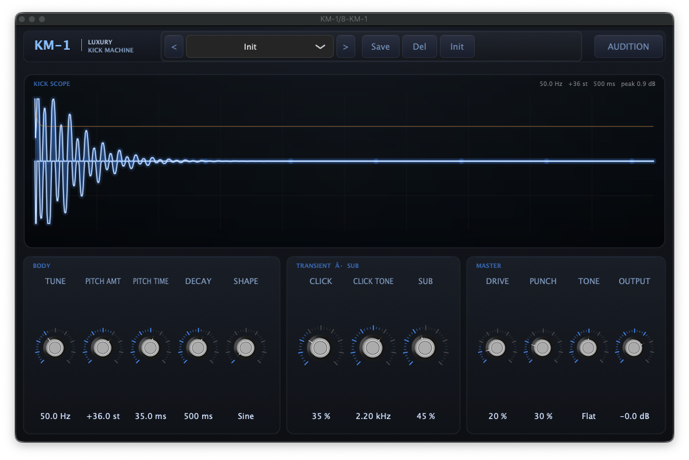

### SN-1 — Snare Machine

**Type:** Instrument — snare-drum synthesizer

SN-1 combines a tuned body with a noise/buzz layer to synthesize snares, claps and rim-style hits. Controls include **Tune**, **Pitch Amt**, **Pitch Time**, **Body Decay**, **Noise Level**, **Noise Color**, **Noise Decay**, **Buzz Q**, **Drive** and **Tone**, with audition. Results range from tight cracks to splashy, open snares.

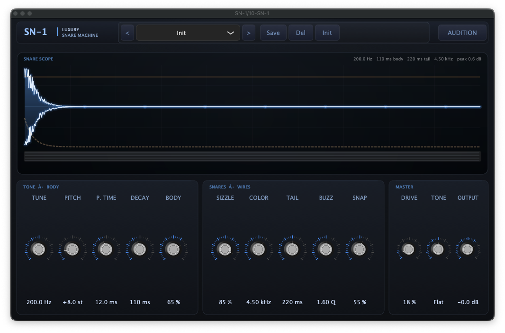

### HH-1 — Hi-Hat Machine

**Type:** Instrument — hi-hat / cymbal synthesizer

HH-1 is a metallic hi-hat and cymbal synthesizer built from tuned metal partials and filtered noise. Controls are **Tune**, **Metal**, **Harmonics**, **HP Cut**, **BP Cut**, **Shimmer Q**, **Decay**, **Hold**, **Noise**, **Color**, **Drive**, **Tone**, **Width** and **Output**. It generates closed and open hats as well as shimmering cymbal sounds.

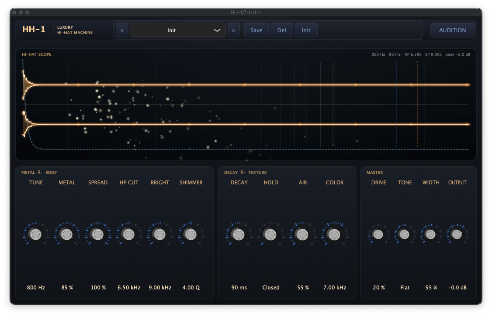

> **CD-1 — Cinematic Drums** is a further instrument plugin that layers Boom, Hit, Crack and Sub elements into big trailer-style impacts, complete with a built-in reverb section. (No screenshot is available yet.)

---

## D. Effect Plugins

Synthlab also includes a comprehensive set of audio effect plugins. They can be inserted on a mixer channel's FX slots or placed in a patch via the **Plugin** module.

### EQ & Dynamics

#### EQ8 — 8-Band Equalizer

**Type:** Effect — parametric equalizer

EQ8 is an eight-band parametric equalizer with low-shelf and high-shelf options and per-band **Frequency**, **Gain** and **Q**. It includes a real-time spectrum analyzer and EQ-curve visualizer for precise corrective and creative tone shaping.

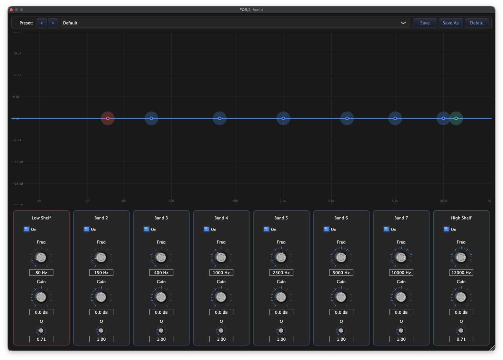

#### CP-1 — Compressor

**Type:** Effect — dynamics compressor (with sidechain)

CP-1 is a full-featured compressor with internal or external sidechain. Controls include **Threshold**, **Ratio**, **Attack**, **Release**, **Knee**, **Makeup**, **Mix**, **Detector** (Peak/RMS), **Stereo Link**, **Auto Release**, **External SC**, **SC HPF** and **SC Listen**. It handles transparent glue, punchy bus compression and sidechain ducking.

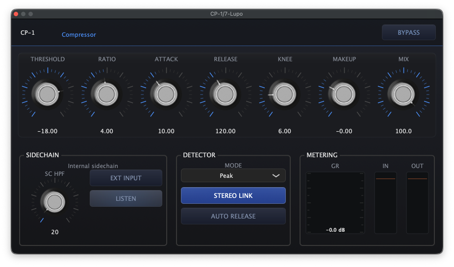

#### LT-1 — Limiter

**Type:** Effect — brickwall / mastering limiter

LT-1 is a brickwall limiter for controlling peaks and raising loudness. Controls are **Input**, **Threshold**, **Ceiling**, **Knee**, **Release** and **Output**. Use it on the master bus or individual tracks to maximize level without clipping.

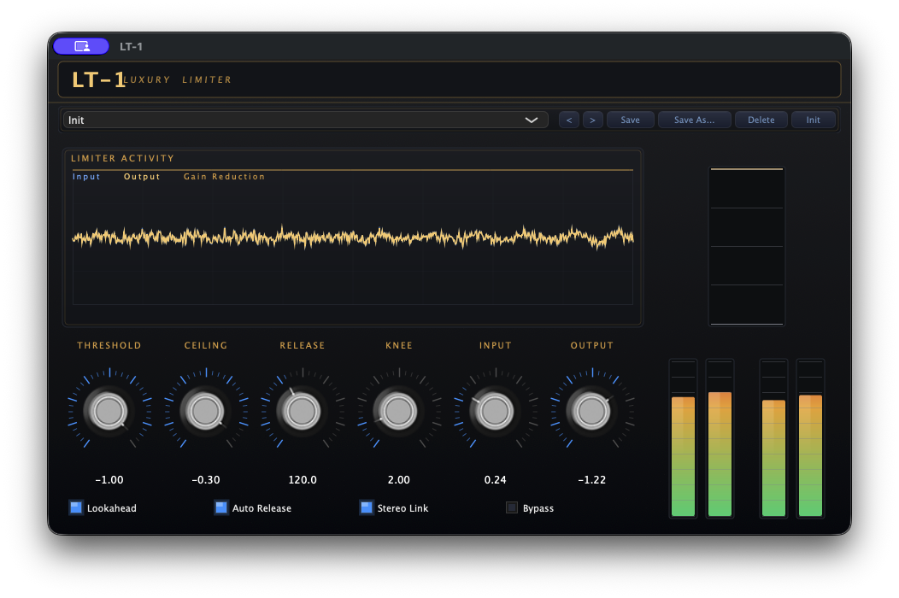

#### TS-1 — Transient Shaper

**Type:** Effect — transient designer

TS-1 independently boosts or softens the **Attack** and **Sustain** of a signal, with **Sensitivity**, **Output**, **Mix** and **Bypass** controls. Use it to add punch to drums, tame sustain, or reshape the dynamics of any signal.

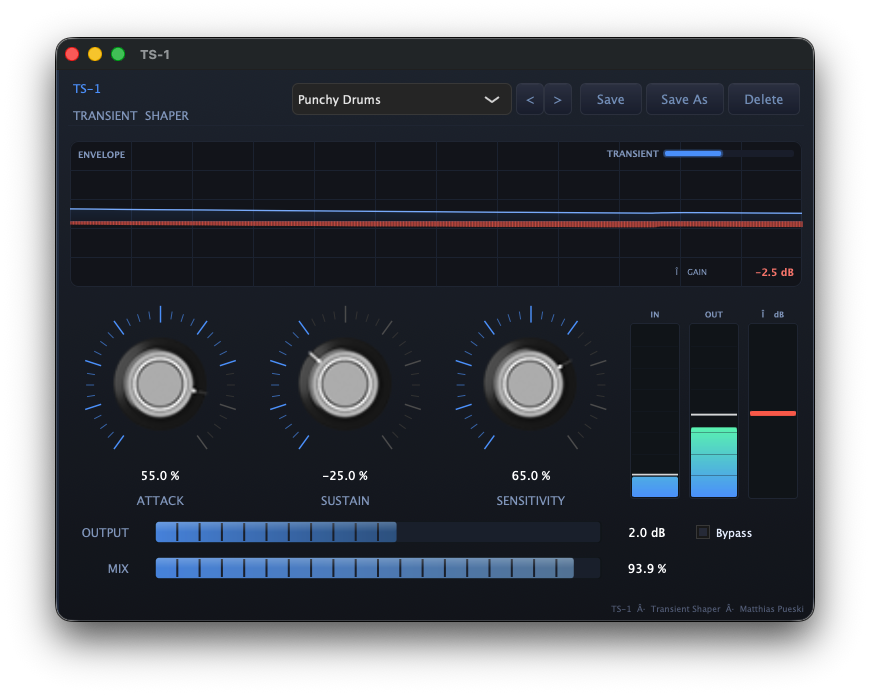

### Saturation & Distortion

#### ST-1 — Saturation

**Type:** Effect — saturation / harmonic distortion

ST-1 is a saturation and harmonic-distortion processor with multiple saturation modes and oversampling. Controls are **Drive**, **Bias**, **Tone**, **Mode**, **Oversampling**, **Mix** and **Output** — from subtle analog warmth to aggressive drive.

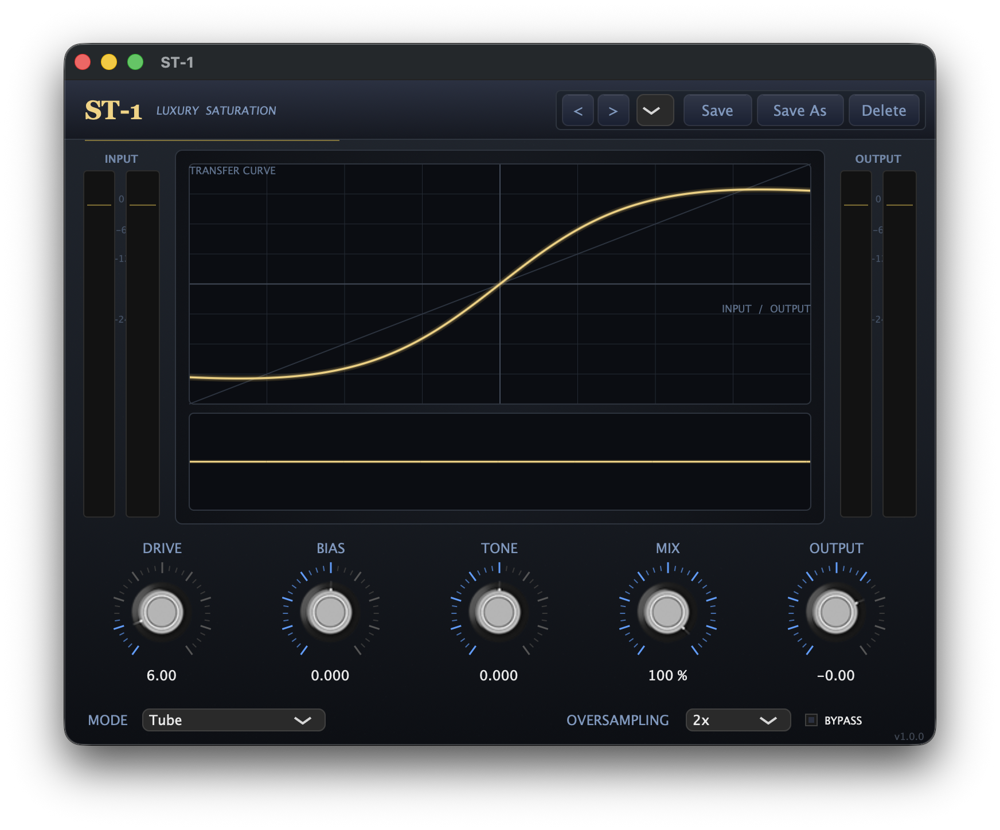

#### BC-1 — Bitcrusher

**Type:** Effect — bitcrusher / sample-rate reducer

BC-1 reduces bit depth and sample rate for digital lo-fi grit. Controls are **Drive**, **Bits**, **Rate**, **Dither**, **Tone**, **Mix** and **Output**, with a crush-scope visualizer. Use it for retro 8-bit textures, aliasing and aggressive digital distortion.

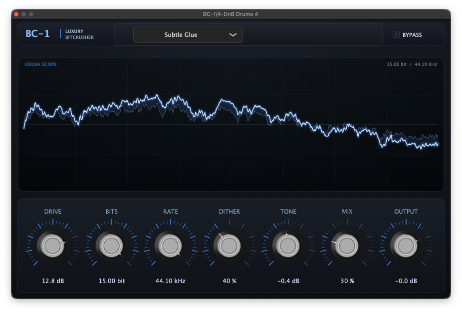

> **TR-1 — Trash** is an additional character distortion / lo-fi multi-effect (Drive, Crunch, Tone, Body, Texture, Motion, Age, Width, Mix and a Character selector) for dirty, degraded and modulated textures. (No screenshot is available yet.)

### Modulation

#### CH-1 — Chorus

**Type:** Effect — stereo chorus

CH-1 is a multi-voice stereo chorus for thickening and widening sounds. Controls are **Rate**, **Depth**, **Delay**, **Feedback**, **Mix**, **Width**, **Voices**, **Tone** and **Output**. It ranges from subtle stereo shimmer to lush, detuned ensemble textures.

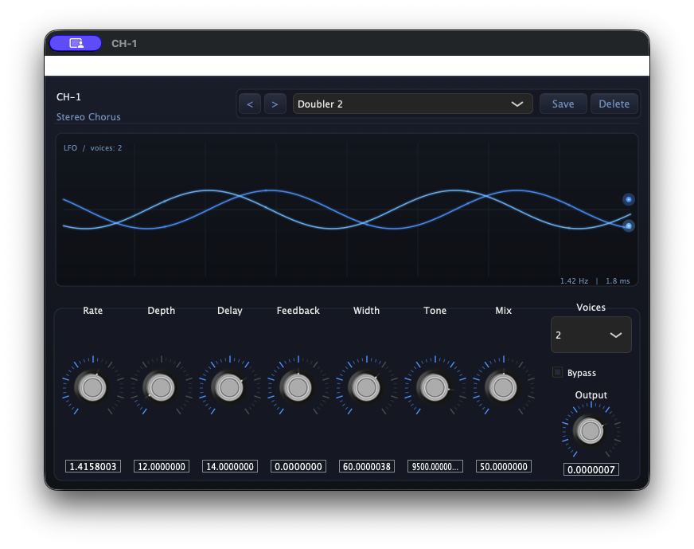

#### FP-1 — Flanger / Phaser

**Type:** Effect — combined flanger and phaser

FP-1 is a dual modulation effect switchable between **Flanger** and **Phaser** modes, with a selectable LFO shape and configurable number of **Stages**. Controls are **Mode**, **LFO Shape**, **Stages**, **Rate**, **Depth**, **Manual**, **Feedback**, **Mix**, **Width**, **Tone** and **Output**. It produces jet-sweep flanging and classic phaser swooshes.

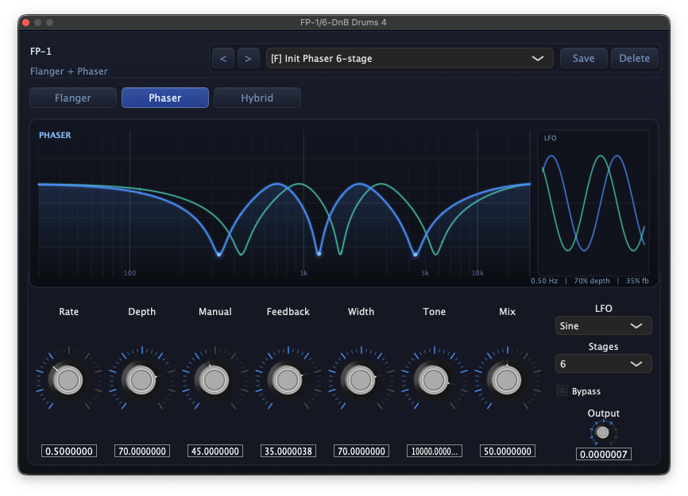

#### AF-1 — AutoFilter

**Type:** Effect — modulated / envelope auto-filter

AF-1 is an auto-filter with a selectable **Filter Type** (Low Pass, Band Pass, High Pass, Notch) driven by an LFO and an envelope follower. Controls are **Cutoff**, **Resonance**, **Drive**, **Slope**, **LFO Rate/Depth/Shape**, **Env Amount/Attack/Release**, **Mix** and **Output**. It creates rhythmic filter sweeps, wahs and envelope-following movement.

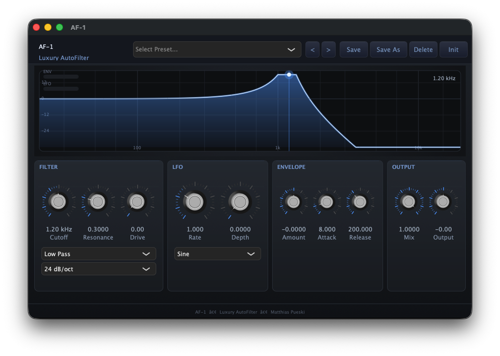

### Delay & Reverb

#### DL-1 — Stereo Delay

**Type:** Effect — stereo / tempo-sync delay

DL-1 is a stereo delay with independent left/right times that can be linked or tempo-synced. Controls include **Input/Output Gain**, **Time L/R**, **Link Times**, **Tempo Sync**, **Feedback**, **Crossfeed**, **High/Low Cut**, **Mod Rate/Depth**, **Drive**, **Width**, **Ducking** and **Mix** — from clean slapbacks to wide, modulated, ducked echoes.

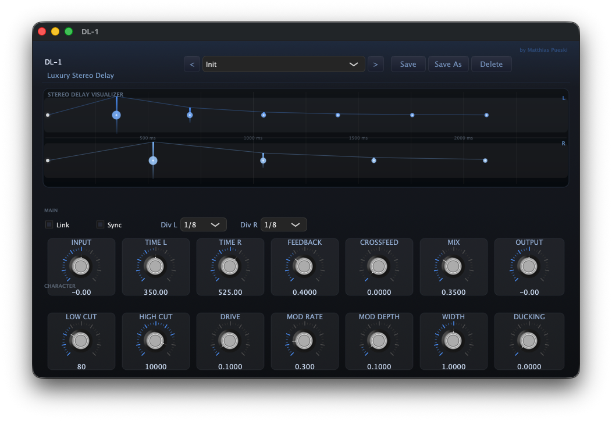

#### RV-1 — Reverb

**Type:** Effect — algorithmic reverb

RV-1 is an algorithmic reverb with a character/preset selector (Cathedral and more) and a live reverb-field visualizer. Main controls are **Size**, **Decay**, **Damping**, **Pre-Delay**, **Modulation** and **Mix**, plus **Diffusion**, **Width**, **Low Cut** and **High Cut** — covering everything from tight rooms to long cathedral tails.

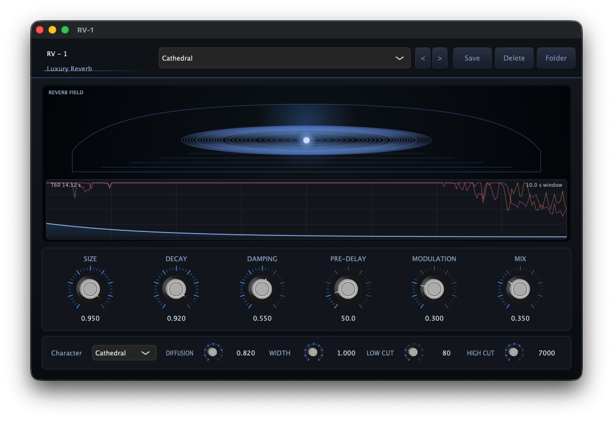

Synthlab also includes the **UltraVerb** reverb, shown below, with delay-network controls such as **Delay**, **Diffusion**, **Feedback**, **Mod Amount/Rate**, **Decay** and **Tip Delay**, plus a particle/spectrum field visualizer:

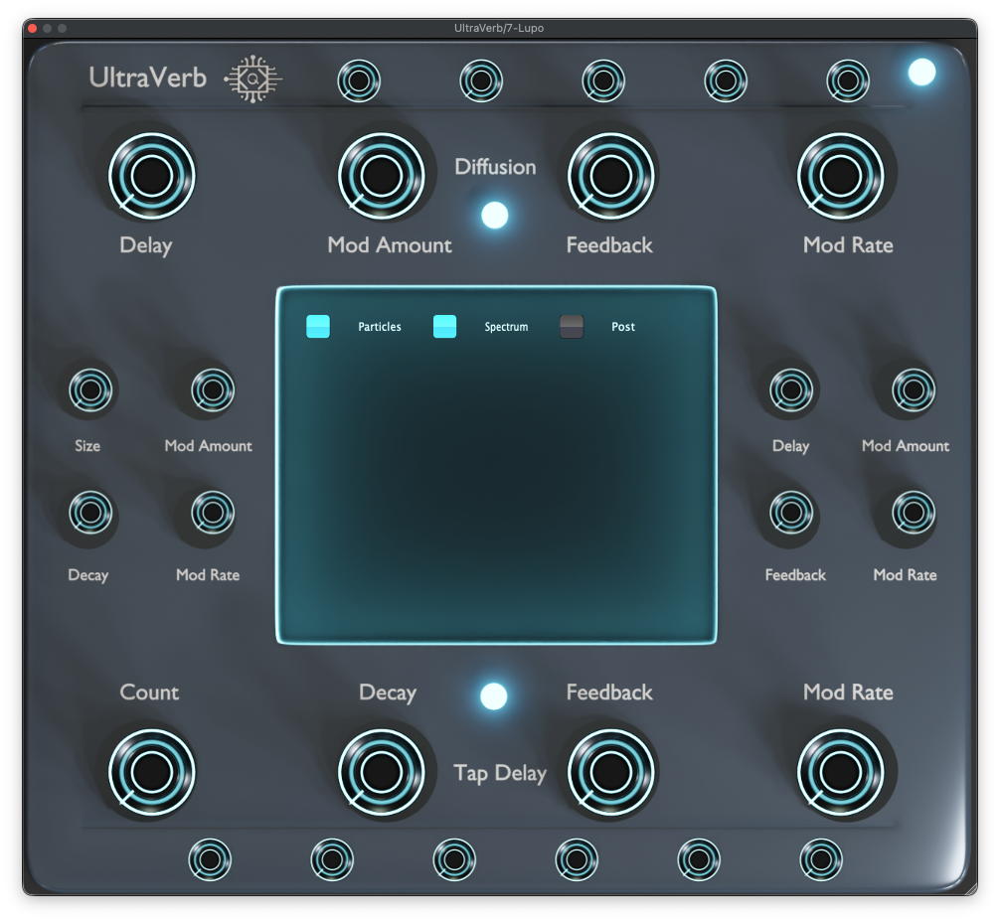

> **CRV-1 — Convolution Reverb** is a further reverb that plays back recorded impulse responses (with a factory IR library and user import) for realistic spaces and creative ambience. Controls include Size, Decay, Pre-Delay, Low/High Cut, Modulation, Width, Mix and Output. (No screenshot is available yet.)

### Pitch & Stereo

#### PS-1 — Pitch Shifter

**Type:** Effect — pitch shifter / harmonizer

PS-1 shifts pitch and adds shimmer/harmony textures. Controls include **Pitch** (semitones) and **Fine**, **Formant**, **Shimmer**, **Crystal**, **Drive**, **Feedback**, **Low/High Cut**, **Width**, **Mix**, **Character** and **Quality**, with **Input** and **Output** gain. Use it for octaves, harmonies and shimmering pitch effects.

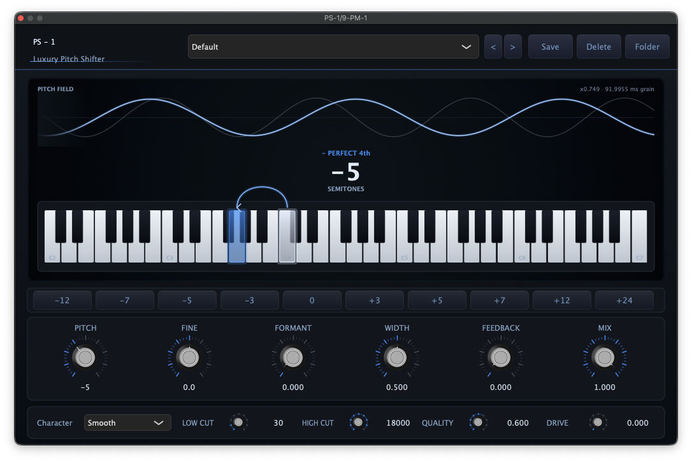

#### SW-1 — Stereo Widener

**Type:** Effect — multiband stereo imaging

SW-1 is a stereo imaging tool with per-band width control and bass-mono protection. Controls include overall **Width**, **Low/Mid/High Width**, the crossover splits, **Bass Mono** (with frequency), **Shimmer**, **Haas**, **Rotation**, **Output** and **Mix**, plus a **Mono Check** and a stereo-field visualizer. It widens or narrows the stereo image while keeping the low end mono and centered.

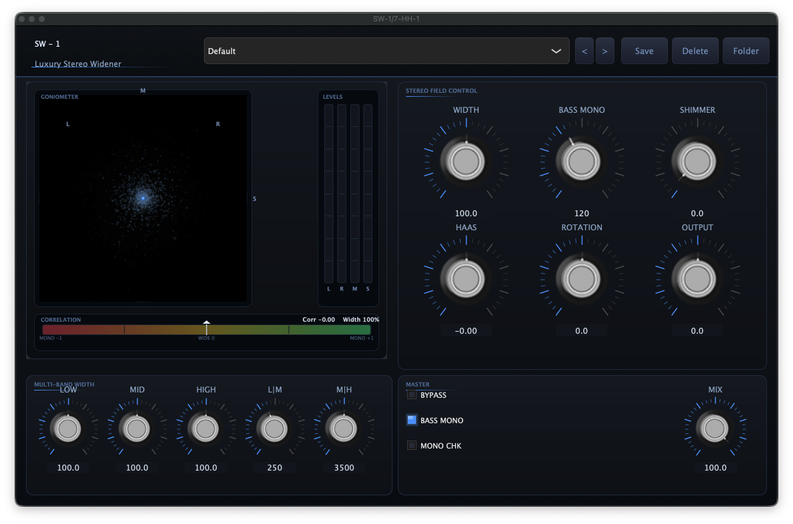

---

## E. Module Reference

Synthlab provides over 80 built-in **modules** — the building blocks you wire together in the patch editor (see [Building Instruments](#12-building-instruments-and-useful-stuff)). Modules are grouped into categories in the **Browse modules** menu; the sections below list every module with a short description of what it does and its most important inputs/outputs.

### Module Icons

Most modules carry a small icon in the node graph. Many share the generic module icon (  ), but the following modules have a distinctive icon:

| Icon | Module(s) | Icon | Module(s) |
| ---- | --------- | ---- | --------- |
| 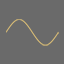 | Sine |  | Sawtooth, SuperSaw |
|  | Pulse |  | White noise |
| 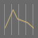 | ADSR |  | Random |
|  | LP filter |  | HP filter |
| 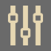 | Mixer | 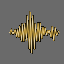 | Sampler |
|  | Stereo delay |  | Chorus |
|  | Add value, Add signal |  | Multiply value |
|  | Invert value |  | Pitch to freq |
|  | Magnitude |  | Vector |
|  | Scope |  | Display value, Event Display |
|  | Audio out |  | Audio in |
|  | Aux out |  | Plugin |
|  | Step sequencer |  | Midi clock |
|  | Midi gate, Pitch bend |  | Midi out |
|  | Midi note |  | Knob |
|  | LED |  | Audio recorder |
|  | And |  | Or |
|  | Not |  | Transform Geometry |
|  | Merge Geometry | | |

### Sound sources

| Module | Description |
|---|---|
| **Sine** | Sine-wave oscillator. Inputs: P (pitch), F (frequency tune), A (amplitude); outputs Out (audio) and V (value for modulation). |
| **Sawtooth** | Sawtooth oscillator with the same P/F/A inputs and Out/V outputs as the Sine module. |
| **Pulse** | Pulse/square oscillator with P (pitch), F (tune), A (amplitude) inputs, plus Pb (pitch bend) and Mod (shape modulation); outputs Out and V. |
| **White noise** | White-noise generator with A (amplitude) and O (offset) inputs. |
| **SuperSaw** | 7-voice detuned saw (JP-8000 style). Inputs P (transpose), F (fine), A (gate/volume), D (detune), M (mix), W (stereo width); stereo L/R outputs plus V peak monitor. |
| **LFO** | Low-frequency oscillator. Inputs R (rate Hz), S (shape: sine/triangle/saw up/saw down/square/S&H), T (sync trigger); outputs Bi (bipolar −1..1) and Uni (unipolar 0..1). |
| **Random** | Generates random values on each trigger. Inputs G (gate), F, A; outputs Out, V and R (random value event, 0..127). |
| **Sampler** | Plays back audio samples. Inputs A (amplitude), E (trigger event), P (pitch), plus L/R audio in; outputs L/R audio. |

### Filter

| Module | Description |
|---|---|
| **LP filter** | Low-pass filter with F (cutoff), R (resonance), In (audio) and Mod (cutoff modulation) inputs and an Out audio output. |
| **HP filter** | High-pass filter with the same F, R, In, Mod inputs and Out output as the LP filter. |
| **SVF** | State-variable filter. Inputs F (cutoff), Q (resonance), Mod, In; simultaneous LP, HP, BP and N (notch) outputs. |
| **Stereo SVF** | Stereo state-variable filter. Inputs InL/InR, F (cutoff Hz), Q, Mod, Drive (tanh saturation); stereo LP/HP/BP/N outputs, optional 24 dB slope. |

### FX

| Module | Description |
|---|---|
| **Stereo delay** | Stereo delay. Audio L/R in and out, with TL/TR (delay time left/right), Fb (feedback) and Mix (dry/wet) inputs. |
| **Reverb** | Stereo reverb. Audio L/R in and out, with Da (damping), Wet, Dry, Si (room size) and Fb (feedback) inputs. |
| **Chorus** | Stereo chorus. Audio L/R in and out, with M (rate/depth), Fb (feedback), Dly (delay) and Mix inputs. |
| **Distortion** | Waveshaping distortion. In/Out audio plus Drive, Mix (dry/wet) and Type (waveshape selector) inputs. |
| **Vocoder** | 32-band vocoder. Inputs Mod (modulator, e.g. voice), Car (carrier, e.g. synth), Shft (formant shift 0.25..4), Mix (dry/wet); Out audio output. |
| **Plugin** | Hosts an external VST/AU plugin. Provides sidechain audio inputs (SC), the plugin's own audio I/O and a G (gate) input. |

### Audio

| Module | Description |
|---|---|
| **Magnitude** | Measures the peak magnitude of an incoming audio buffer. In (audio) input, Mag (value) output. |
| **Mixer** | Multi-channel mono mixer summing several In ports, each with its own A (attenuation) input, into a single Out. |
| **Stereo Mixer** | Multi-channel stereo mixer; each channel has InL/InR audio inputs and an A level input, summed to OutL/OutR. |
| **Gain** | Applies gain to an audio signal. Audio In and Audio Out ports plus a Gain control input. |
| **Audio recorder** | Records incoming stereo audio to a file. Inputs L/R (audio in) and Tr (trigger); passes L/R audio through to outputs. |
| **Audio selector** | Routes one of three audio inputs (A, B, C) to the Out port based on the Sel value input (0/1/2). |
| **Seq Switch** | Sequential switch that routes the In audio to one of several outputs (O1, O2…), advancing on each Clk event, with a Rst reset and Step indicator. |
| **3-Band EQ** | Three-band parametric EQ. In/Out audio plus frequency, Q and gain inputs for low (LF/LQ/LG), mid (MF/MQ/MG) and high (HF/HQ/HG) bands. |

### Math

| Module | Description |
|---|---|
| **Add signal** | Sums two audio signals A and B into output C. |
| **Add value** | Adds two control values A and B, output on C. |
| **Multiply value** | Multiplies two control values A and B, output on C. |
| **Invert value** | Outputs the reciprocal (1/a) of input value A. |
| **Pitch to freq** | Converts a pitch/note value (In) into a frequency in Hz (Out). |
| **Compare** | Compares values A and B using a selectable mode (equal, greater, less) and outputs 1 or 0 on C. |
| **Constant** | Emits a fixed, user-editable constant value on its V output. |
| **Vector** | Combines three scalar inputs X, Y, Z into a single 3D vector output V. |
| **Feedback** | Routes a signal from In to Out while exposing an FB feedback tap for building feedback loops. |
| **Attenuverter** | Scales and offsets the In value: Out = In × S (scale, can be negative) + O (offset). |
| **Slew** | Slew-rate limiter that smooths the In value with separate R (rise) and F (fall) rates; Out output. |
| **S&H** | Sample-and-hold; captures the In value when a T trigger arrives and holds it on Out. |
| **Quantizer** | Snaps the In pitch to the nearest note of a musical scale, set by S (scale) and R (root); Out outputs the quantized note. |

### Logic

| Module | Description |
|---|---|
| **And** | Logic AND of inputs A and B; Out is 1 when both are positive, with a complementary Not output. |
| **Or** | Logic OR of inputs A and B; outputs 1 on C if either is positive. |
| **Not** | Logic inverter; output B is 1 when input A is not positive, otherwise 0. |
| **Binary Counter** | Counts Clk events upward (Rst resets), exposing the decimal Val output and individual bit outputs (B0, B1…). |
| **T-Flip-Flop** | Toggle flip-flop. T/Tv toggle the state on each rising edge, Rst/Rv reset to 0; outputs Q and its complement /Q. |

### MIDI

| Module | Description |
|---|---|
| **Midi gate** | Produces gate signals from MIDI note on/off; G (gate value, with velocity/note) and E (event) outputs. |
| **Midi out** | Sends MIDI to a selectable hardware/software output device. Inputs G (gate), N (note), C (controller), P (pitch). |
| **Midi note** | Outputs a note's pitch/frequency on P and an associated event on V. |
| **Midi clock** | Generates clock-driven gates. Outputs G (gate value with velocity/note) and E (event for all 128 notes). |
| **Pitch bend** | Outputs the current pitch-bend amount as a value on P and as an event on E. |
| **Step sequencer** | Step sequencer with an editable pattern; the G event input clocks it, and the G event output fires the programmed notes. |
| **Trigger timer** | Periodically fires gate/event triggers on a timer (interval-based); G gate input, G/E outputs. |
| **Trigger Script** | Runs a bound JavaScript macro when a gate-on event arrives on its G input; the selected script filename is shown on the module. |
| **Clock Div** | Clock divider; passes every N-th Clk event to Out, with N set by the divisor input (default 4). |
| **Midi Recorder** | Records and plays back MIDI through MIDI IN and MIDI OUT ports. |
| **ValueToEvent** | Converts a continuous V value input into MIDI controller events on E whenever the value changes. |

### Input / Output

| Module | Description |
|---|---|
| **ADSR** | ADSR envelope generator. Inputs G (gate), A, D, S, R (attack/decay/sustain/release); envelope on Out. |
| **Audio out** | Routes signal to the main audio output. Stereo L and R inputs. |
| **Audio in** | Brings the hardware audio input into the patch via its In output port. |
| **Aux out** | Sends audio to an auxiliary bus with adjustable volume. Stereo L/R inputs. |
| **Bus out** | Routes track audio to an internal stereo bus (tracks send via the mixer's send logic). |
| **Track In** | Brings a sequencer track's signal into the patch. Stereo L/R audio in/out plus G (gate) ports. |
| **Terminal In** | Named terminal that injects a value into the patch (a labeled entry point), with an In output pin. |
| **Terminal Out** | Named terminal that taps a value out of the patch, with an Out input pin; its type can match the connected signal. |

### Controls

| Module | Description |
|---|---|
| **Knob** | User-adjustable rotary knob (mapped to a configurable min/max) that outputs its value on V. |
| **Slider** | User-adjustable vertical slider outputting its value on V and a change event on E. |
| **Pad** | Trigger pad producing a gate value (G, with velocity/note) and an event (E) when pressed. |
| **LED** | Indicator light driven by its V value input. |
| **Label** | Static text label for annotating the patch (no signal ports). |
| **TextInput** | Editable text field; exposes its entered text/value on the V output. |
| **Image** | Displays a user-supplied image in the patch (decorative, no signal ports). |
| **Keyboard** | On-screen piano keyboard producing a gate (G, with velocity/note) and an event (E) output. |
| **Radio group** | Group of mutually exclusive buttons; outputs the selected index on Val. |
| **Publisher** | Broadcasts its V input value on a named topic over the internal message bus (wireless link). |
| **Subscriber** | Receives a named-topic value from the message bus and outputs it on V (wireless counterpart to Publisher). |

### Debug

| Module | Description |
|---|---|
| **Scope** | Oscilloscope display. In (audio) signal plus P, Xs (X scale) and Ys (Y scale) value inputs to control the trace. |
| **Display value** | Numerically displays an incoming value; accepts both a V value input and a V event input. |
| **Event Display** | Lists incoming events in a scrolling box for debugging; single Events input. |

### Graphics

| Module | Description |
|---|---|
| **Geometry** | 3D geometry view that renders a Geom input, transformed by T (translate), R (rotate) and S (scale) vector inputs. |
| **Transform Geometry** | Applies T (translate), R (rotate) and S (scale) vectors to a Geom input and outputs the transformed geometry on Out. |
| **Merge Geometry** | Combines two geometry inputs (Geom1, Geom2) into a single merged Out geometry. |
| **Donut** | Generates a torus/donut 3D mesh on its Geom output. |
| **Box** | Generates a box/cube 3D mesh on its Geom output. |

---

## F. JavaScript API

Synthlab embeds a JavaScript engine (Duktape) that lets you inspect and edit a project programmatically — handy for batch edits, generative composition and automated smoke tests. Scripts run in two places:

- **The JavaScript Editor** — open it from **View → JavaScript Editor**. Type a script and run it with **Cmd-R** / **Cmd-Enter** (Ctrl on Windows/Linux) or the **Run** button. Output from `print()` and `console.log()` appears in the panel below the editor; the script's return value is shown as `=> value` and errors are printed in red. Autocomplete is available with **Ctrl-Space** (or **Cmd-I** as a collision-free fallback on macOS).
- **The Trigger Script module** — see the [Module Reference](#midi). A `.js` macro placed in `~/.Synthlab/macros/` can be bound to the module and is executed (with the same API described here) whenever a gate-on event reaches its **G** input.

Each run executes in a fresh engine context, so global variables do not persist between runs.

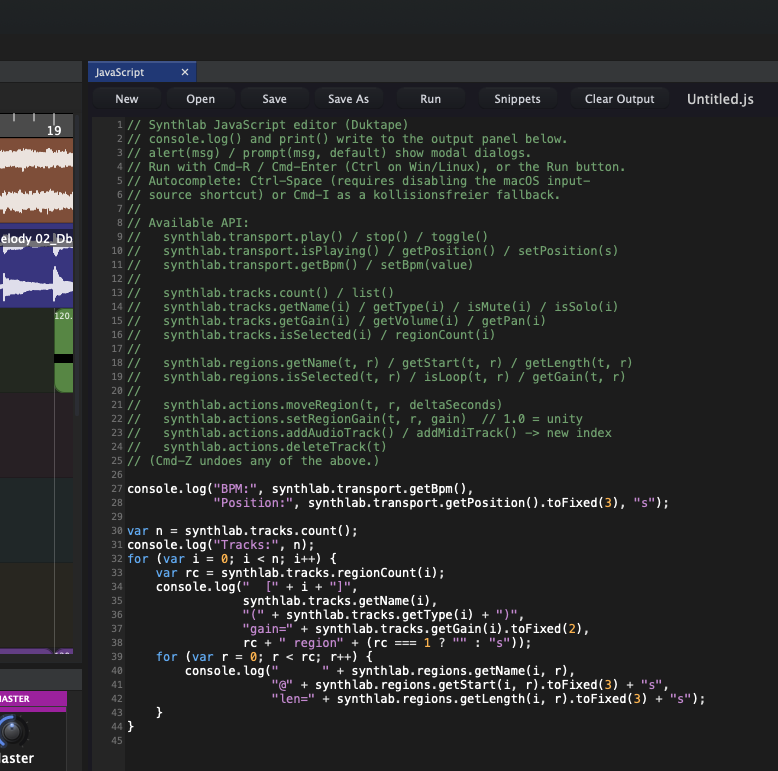

### Global functions

These are available at the top level, without the `synthlab` prefix:

| Function | Description |
|---|---|
| `print(...args)` | Writes its arguments to the output panel. |
| `console.log(...args)` | Same as `print()` — writes to the output panel. |
| `console.error(...args)` | Writes to the output panel as an error. |
| `alert(message, [title])` | Shows a modal information dialog; blocks until dismissed. |
| `prompt(message, [default], [title])` | Shows a modal input dialog; returns the entered string, or `null` if cancelled. |

### `synthlab` — API root

Everything else lives under the global `synthlab` object, grouped into namespaces. Throughout, **`t`** is a zero-based track index, **`r`** a zero-based region index within that track, and **`i`** a note index within a region.

#### `synthlab.transport` — playback, tempo & recording

| Method | Description |
|---|---|
| `play()` | Start playback. |
| `stop()` | Stop playback. |
| `toggle()` | Toggle play/stop. |
| `isPlaying()` | → `bool`. |
| `getPosition()` | → playhead position in seconds. |
| `setPosition(seconds)` | Move the playhead. |
| `getBpm()` | → project tempo. |
| `setBpm(value)` | Set the project tempo. |
| `isRecording()` | → `bool` — global record state. |
| `setRecording(bool)` | Start/stop recording. |
| `getMetronome()` | → `bool`. |
| `setMetronome(bool)` | Enable/disable the click during recording. |

#### `synthlab.tracks` — read track state

| Method | Description |
|---|---|
| `count()` | → number of tracks. |
| `list()` | → array of track names (`string[]`). |
| `getName(t)` | → `string`. |
| `getType(t)` | → `"audio"`, `"midi"` or `"instrument"`. |
| `isMute(t)` / `isSolo(t)` | → `bool`. |
| `getGain(t)` / `getVolume(t)` / `getPan(t)` | → `number`. |
| `isSelected(t)` | → `bool`. |
| `regionCount(t)` | → number of regions on the track. |
| `isRecording(t)` | → `bool` — whether the track is armed. |
| `setRecording(t, bool)` | Arm/disarm the track for recording. |

#### `synthlab.regions` — read region state

| Method | Description |
|---|---|
| `getName(t, r)` | → `string`. |
| `getStart(t, r)` | → start position in seconds. |
| `getLength(t, r)` | → length in seconds. |
| `isSelected(t, r)` | → `bool`. |
| `isLoop(t, r)` | → `bool`. |
| `getGain(t, r)` | → `number` (`1.0` = unity). |
| `noteCount(t, r)` | → number of MIDI note-ons in the region. |
| `getNote(t, r, i)` | → `{ pitch, velocity, channel, startSec, lengthSec }`. |

#### `synthlab.actions` — undoable edits

All edits in this namespace go through the undo manager, so **Cmd-Z** reverts them (except `addMidiClip`, which is marked as non-undoable).

| Method | Description |
|---|---|
| `moveRegion(t, r, deltaSeconds)` | Shift a region in time. → `bool`. |
| `setRegionGain(t, r, gain)` | Set region gain (`1.0` = unity). → `bool`. |
| `addMidiClip(t, startSec, lenSec)` | Add an empty MIDI clip; returns its index. *(no undo)* |
| `addNote(t, r, pitch, vel, startSec, lenSec, [ch])` | Add a MIDI note to a region. → `bool`. |
| `deleteNote(t, r, noteIdx)` | Remove a note. → `bool`. |
| `addAudioTrack()` | → index of the new track. |
| `addMidiTrack()` | → index of the new track. |
| `addInstrumentTrack(pluginName)` | Add an instrument track for the named plugin. → new index. |
| `deleteTrack(t)` | → `bool`. |
| `undo()` | Pop one undo step. → `bool`. |
| `redo()` | → `bool`. |

#### `synthlab.plugins` — available instruments

| Method | Description |
|---|---|
| `list()` | → array of instrument plugin names (`string[]`). |

#### `synthlab.ui` — UI side-effects

These are non-undoable interface actions.

| Method | Description |
|---|---|
| `openPlugin(t)` | Open the plugin editor window for the track. → `bool`. |
| `openTrackView()` | Bring the Tracks tab to the front. → `bool`. |

#### `synthlab.project` — save / load / clear

| Method | Description |
|---|---|
| `save(path)` | Write the project to a `.slb` file (no dialog). → `bool`. |
| `load(path)` | Load a `.slb` file (no prompt). → `bool`. |
| `clear()` | New project (File → New, no prompt). → `bool`. |
| `getCurrentPath()` | → path of the current `.slb` file. |
| `isDirty()` | → `bool` — unsaved changes. |

#### `synthlab.test` — assertion helpers

Used by self-test macros; an assertion failure throws, which the editor reports as an error.

| Method | Description |
|---|---|
| `assert(cond, [msg])` | Throws if `cond` is falsy. |
| `assertEquals(actual, expected, [msg])` | Throws unless the values are equal. |
| `assertThrows(fn, [msg])` | Expects `fn()` to throw. |

### Example

```javascript
// Report tempo and list every track with its type and region count.
console.log("BPM:", synthlab.transport.getBpm(),
            "Position:", synthlab.transport.getPosition().toFixed(3), "s");

var n = synthlab.tracks.count();
for (var t = 0; t < n; t++) {
    console.log(t, synthlab.tracks.getName(t),
                "(" + synthlab.tracks.getType(t) + ")",
                synthlab.tracks.regionCount(t), "regions");
}

// Add a MIDI track, give it a one-bar clip and write a C-major chord into it.
var track = synthlab.actions.addMidiTrack();
var clip  = synthlab.actions.addMidiClip(track, 0.0, 2.0);   // 2 seconds long
[60, 64, 67].forEach(function (pitch) {
    synthlab.actions.addNote(track, clip, pitch, 100, 0.0, 2.0);
});
// Cmd-Z undoes the note adds and the track creation.
```
