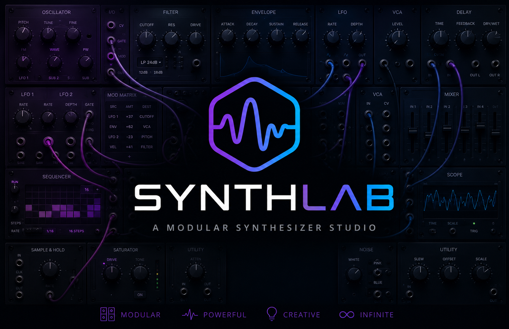

# Synthlab Manual

---

## Table of Contents

1. [Getting Started](#1-getting-started)
2. [Settings](#2-settings)
3. [General Settings](#3-general-settings)
4. [Mixer](#4-mixer)
5. [Piano Roll](#5-piano-roll)
6. [Record Arming Tracks](#6-record-arming-tracks)
7. [Track Navigator](#7-track-navigator)
8. [Track Properties](#8-track-properties)
9. [Regions](#9-regions)
10. [Duplicating Regions](#10-duplicating-regions)
11. [Signal Structure](#11-signal-structure)
12. [Building Instruments](#12-building-instruments-and-usefull-stuff)

**Appendix**

- [A. Lupo Synthesizer](#a-lupo-synthesizer)
- [B. SA-1 Drum Sampler](#b-sa-1-drum-sampler)

---

## 1. Getting Started

When you first launch Synthlab, you are greeted with the main application window. The interface is divided into several areas: the toolbar at the top, the Editor in the center, panels for the Browser, Properties, and Instruments on the sides, and the tool panel at the bottom which provides access to the Mixer, Level Meter, Spectrum analyzer, and Piano Roll.

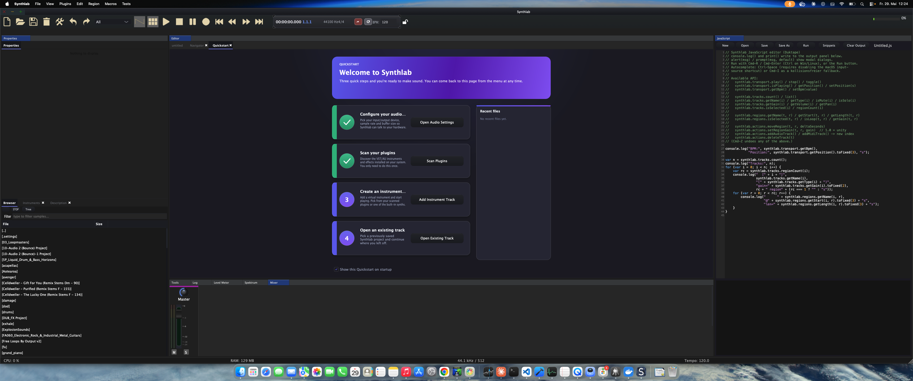

You may drag and reorder the window layout at any time, it will be saved automatically and will be restored the next time you start Synthlab.

---

## 2. Settings

The Settings dialog gives you access to all global application preferences, including audio device configuration, MIDI setup, and behavior options.

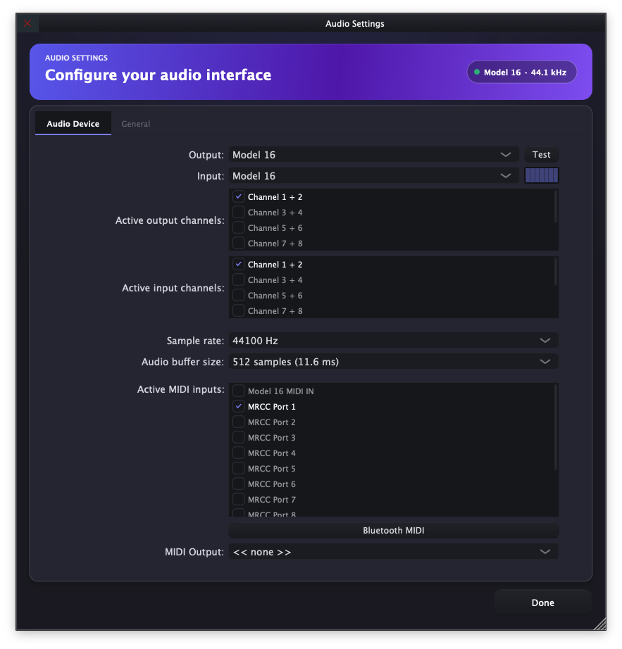

---

## 3. General Settings

The General settings tab contains options that affect the overall behavior of Synthlab, such as default tempo, project path, and UI preferences.

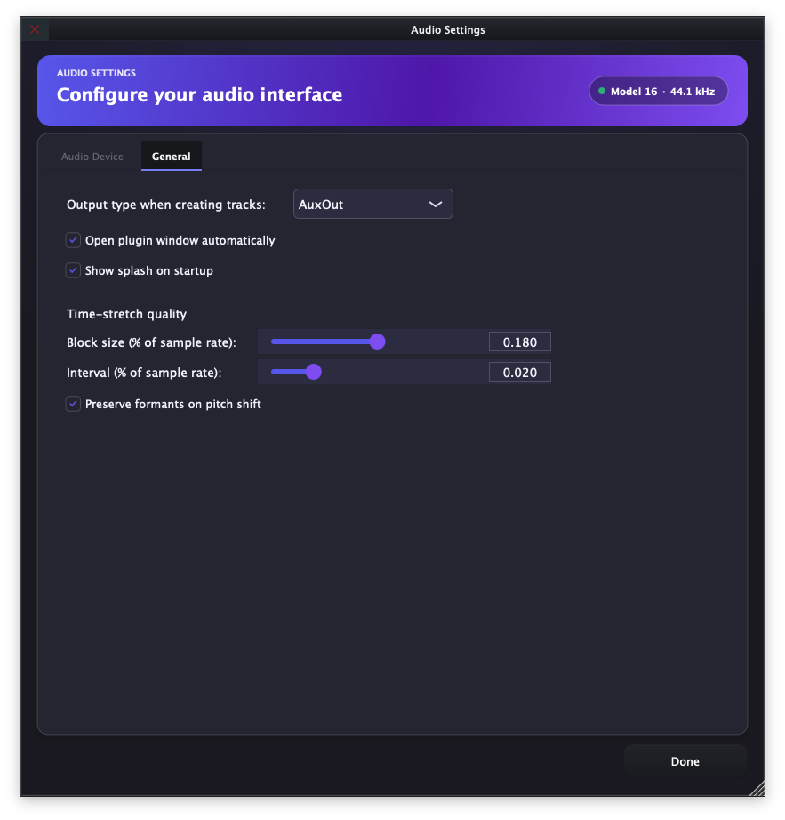

---

## 4. Mixer

The Mixer is accessible via the bottom panel. It displays all active tracks as individual channel strips, each with a volume fader, a pan knob, Mute (**M**) and Solo (**S**) buttons, FX insert slots, and a Sends section for routing to auxiliary buses.

Channels are grouped into **AUX** outs **AUDIO** outs, **BUS** outs and a **MASTER** channel on the far right. The colored LED meters on each strip show real-time signal levels.

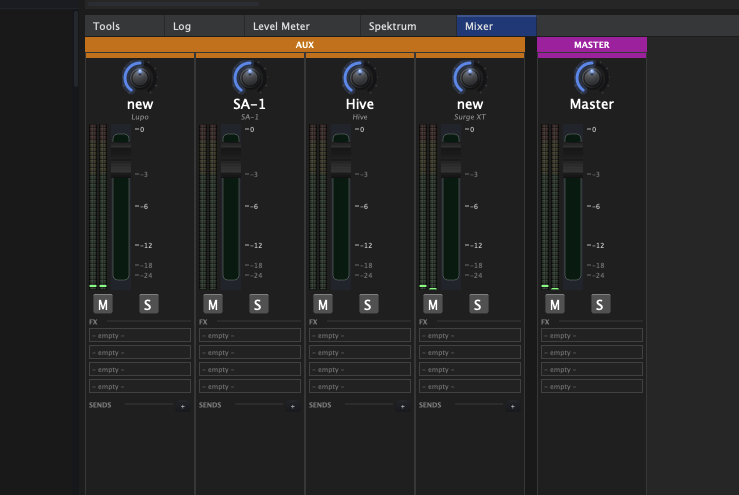

---

## 5. Piano Roll

The Piano Roll editor opens in the bottom panel and allows you to draw, edit, and arrange MIDI notes. The toolbar at the top provides tools for **Select**, **Pencil**, **Eraser**, **Velocity**, and **Split**, as well as controls for the grid resolution, scale, snap, note display, and patterns.

The Piano Roll Editor provides the following shortcuts:

| Shortcut    |  Function        |
| -------     | -----------------|
| CMD + A     | Select all notes |
| Cursor Up   | Move selected notes up |
| Cursor Down | Move selected notes down |
| Shift + Cursor Up   | Move selected notes one octave up |
| Shift + Cursor Down | Move selected notes one octave down |
| Cursor Left   | Move selected notes to the left on the raster |
| Cursor Right  | Move selected notes to the right on the raster |
| Shift + Cursor Left   | Shortens selected notes to the left on the raster |
| Shift + Cursor Right  | Lengthens  selected notes to the right on the raster |

The keyboard on the left side of the roll indicates pitch. Notes are displayed as horizontal bars in the grid; their horizontal position represents timing and their length represents duration.

The Piano Roll shares the bottom panel with the Mixer, Level Meter, and Spectrum analyzer — click the **Piano Roll** tab to switch to it.

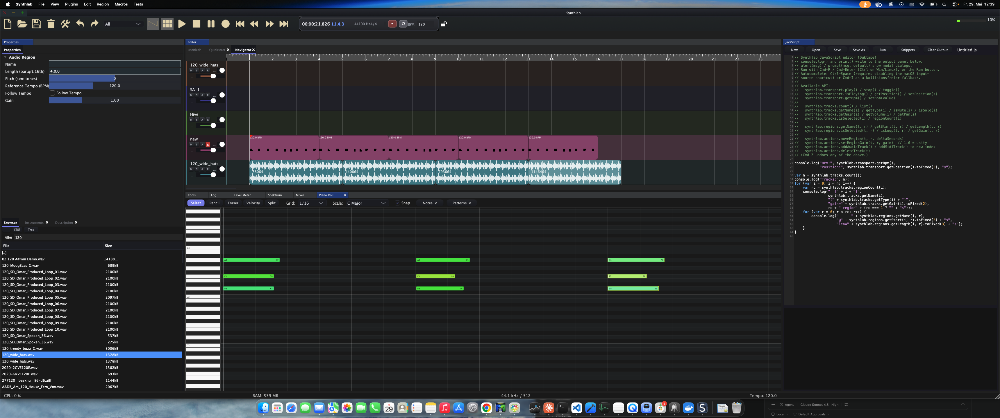

---

## 6. Record Arming Tracks

To record MIDI input onto a track, you must first arm it for recording. Click the **R** button on the track header. An armed track will show the **R** button highlighted in red.

In the example below, the **Lupo** track is armed and ready to record, while the **SA-1** track is not.

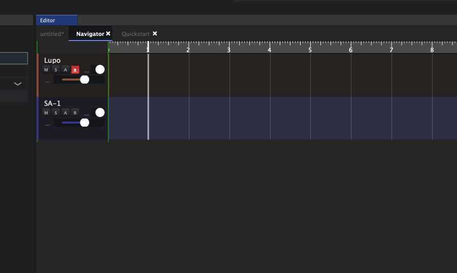

---

## 7. Track Navigator

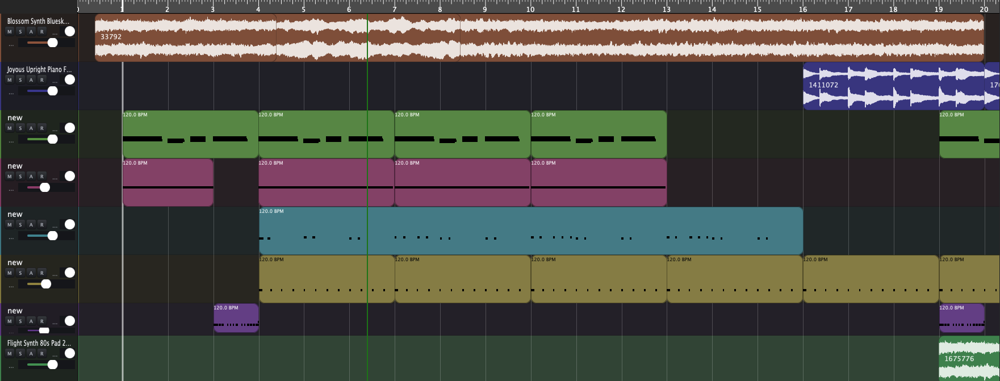

The Track Nabigator gives you the ability to navigate in your composition.

In order to select a track left click in the according track lane. To resize a track just grab the track separator between the tracks and drag it with the mouse. If you'd like to resize all tracks simultaneously, hold the OPTION key while dragging.

**Tracks can currently not be reordered**

The Track Navigator responds to the following keyboard shortcuts:

| Shortcut | Function |
| -------- | -------- |
| Space    | Start / stop playback |
| +        | Zoom in (horizontal) |
| -        | Zoom out (horizontal) |

The transport shortcut (**Space**) works globally, from any panel. The zoom shortcuts require the Track Navigator to have keyboard focus — click into the timeline first.

---

## 8. Track Properties

Clicking on a trackopens the **Properties** panel on the left side of the Editor. Here you can configure:

- **Name** — the display name of the track
- **Recording** — enable or disable recording for this track
- **Type** — the track type (e.g. `INSTRUMENT`)
- **Channel** — the MIDI channel the track listens on

The **Show Plugin** button at the bottom opens the instrument plugin associated with the track.

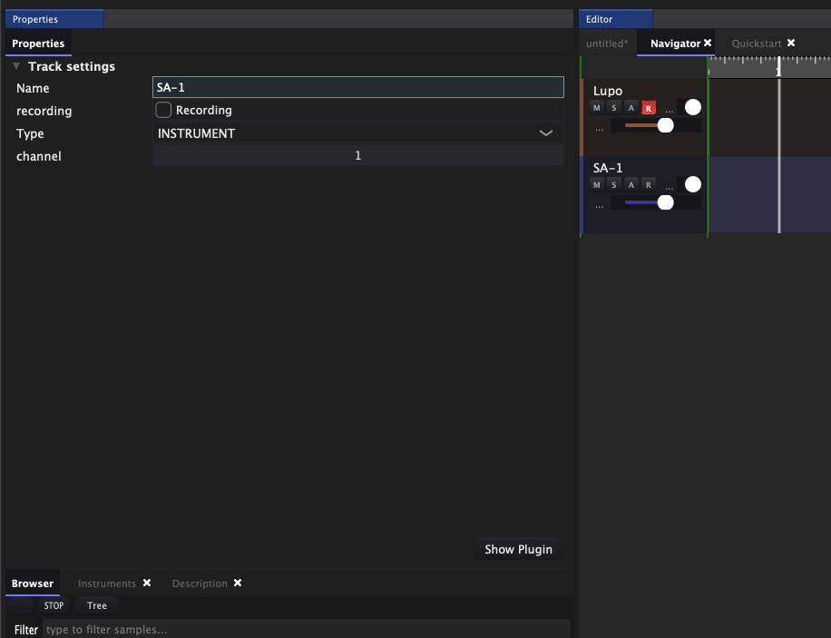

---

## 9. Regions

A **Region** is the fundamental building block of a track in Synthlab. Each region holds MIDI note data for an instrument track (or audio data for audio tracks). Regions are displayed as colored blocks on the timeline and can be moved, resized, duplicated, or deleted.

The BPM of the project is shown in the top-left corner of each region.

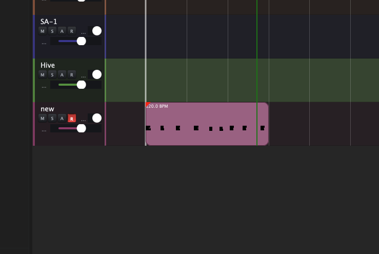

Regions can be selected, moved or resized, select and move the region with the right mouse button, the right button just positions the Track marker at a new position, with the left mouse button ayou can change the selected track.

The commands for editing regions are common for MIDI and AUDIO regions:

| Shortcut    |  Function        |
| -------     | -----------------|
| CMD + C     | Copy selected region(s) to the clipboard |
| CMD + V     | Paste region(s) at the playhead into the current track |
| CMD + D     | Duplicate selected region(s) |
| CMD + X     | Cut selected region(s) (copy, then remove) |
| CMD + T     | Split selected region(s) at the marker |
| CMD + L     | Toggle loop on the selected region(s) |
| CMD + E     | Open the current MIDI region in the Piano Roll |
| CMD + M     | Open the current MIDI region in the Event Editor |
| CMD + B     | Bounce the selected region(s) in place |

There are two types of regions.

### MIDI Regions

MIDI Regions hold MIDI notes and events such as CC changes or automation data. If you double click a MIDI Region, the Piano Roll editor will be opened. Selecting a MIDI region shows its **Name** and **Length** in the Properties panel.

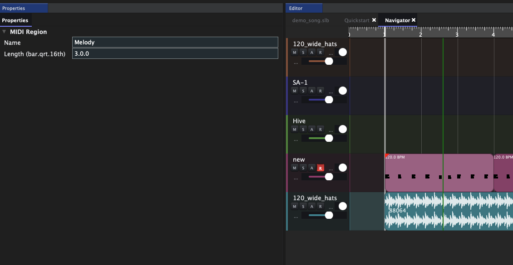

### Audio Regions

Audio Regions hold audio data and can be moved and resized the same way MIDI regions do. In addition to **Name** and **Length**, the Properties panel for an audio region exposes:

- **Pitch (semitones)** — transpose the audio up or down
- **Reference Tempo (BPM)** — the tempo the audio was recorded at
- **Follow Tempo** — when enabled, the region is time-stretched to follow the project tempo
- **Gain** — playback level of the region

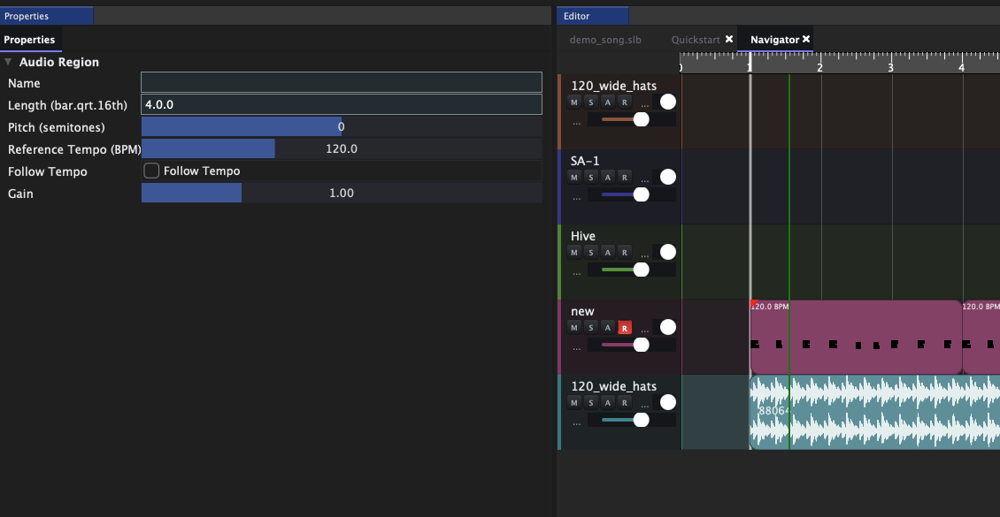

---

## 10. Duplicating Regions

You can duplicate a MIDI region to fill a timeline quickly. Select a region and use the duplicate command to create multiple consecutive copies. The duplicated regions will appear back-to-back across the timeline, each inheriting the original's content and tempo information.

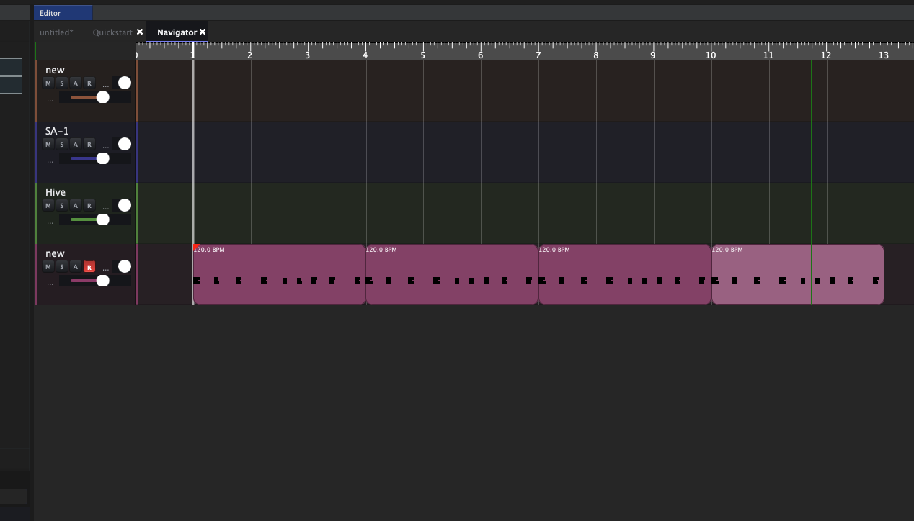

---

## 11. Signal Structure

The **Structure** view (accessible via the Editor tabs) shows the internal signal routing of your project as a node graph. Each track row consists of:

- **Gate** — controls when the track is actives
- **Track In** — receives the MIDI or audio input
- **Plugin** — the instrument or effect assigned to the track
- **Aux** — the output bus the track is routed to

This view is useful for understanding and customizing the signal flow of complex projects.

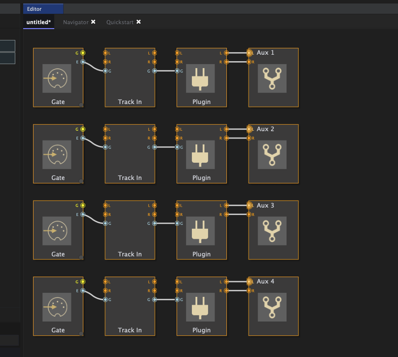

---

## 12. Building Instruments and Useful Stuff

As you might have guessed, you can also build your own instruments with Synthlab in a convenient way. For this, Synthlab provides over 80 modules. We will not be discussing each module here in detail; if you want to know what each module does, see the appendix for reference.

### Basics

Every instrument in Synthlab is a **patch** — a graph of modules wired together. The same patch can be viewed two ways: as a clean front panel of controls, and as the underlying node graph.

Consider the following front panel of a patch:

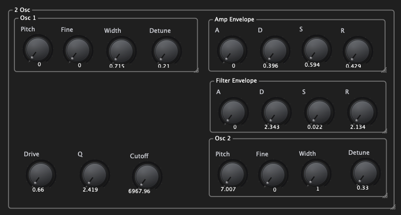

The patch behind this panel looks like this:

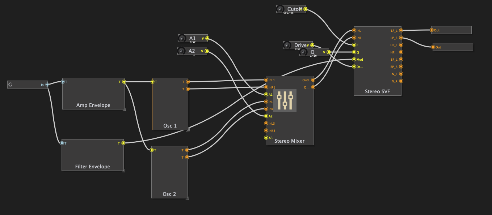

This patch contains most of the conceptual things of Synthlab you need to know.

You can switch the editor between **Controls only** (front panel) and the full graph using the view selector in the toolbar. The "Controls only" view of a three-oscillator instrument together with its mixer looks like this:

…and the corresponding full module graph:

### Adding Modules

New modules are added from the **Browse modules** menu. Press **Shift + A** (or right-click the canvas) to open it, type to filter the list, and click a module to drop it onto the canvas.

### A Drum Patch

Modules are not limited to synthesizers. The patch below drives a **Sampler** from a **Step sequencer** and an **ADSR**, through a stereo delay to the audio out — a complete drum machine built from modules:

### The Console

Synthlab includes a built-in console for driving the application with text commands. Type `help` for a list of available commands — from here you can add tracks and regions, manage MIDI and audio, add or delete modules, and inspect the current track.

### Patch Editor Shortcuts

When the instrument editor (Structure / patch view) has focus, the following shortcuts are available:

| Shortcut           | Function |
| ------------------ | -------- |
| Shift + A          | Open the **Browse modules** menu at the mouse position |
| Ctrl + A           | Select all modules |
| CMD + D            | Duplicate the selected module(s) |
| Alt + D            | Duplicate the selected module(s) |
| Delete / Backspace | Delete the selected modules and connections |
| CMD + N            | New patch |
| CMD + S            | Save |
| CMD + Shift + S    | Save As… |
| CMD + L            | Load |

### Playing with the Computer Keyboard

You can play the instrument on the currently selected track straight from your computer keyboard. The keys are laid out like a piano — the lower letter row plays the white keys and the upper row the black keys:

| Key | Note | Key | Note |
| --- | ---- | --- | ---- |
| A   | C    | E   | D♯   |
| S   | D    | T   | F♯   |
| D   | E    | Z   | G♯   |
| F   | F    | U   | A♯   |
| G   | G    | O   | C♯ (next octave) |
| H   | A    |     |      |
| J   | B    |     |      |
| K   | C (next octave) | | |

Use **X** to shift the keyboard one octave up and **Y** to shift it one octave down. **L** cycles the active editor layer.

# Appendix — Plugins and Synthesizers

## A. Lupo Synthesizer

**Lupo** is Synthlab's built-in polyphonic synthesizer. It features four oscillators, each with controls for **Pitch**, **Fine**, **Width**, **Spread**, and **Shape** (waveform selector with options including Sawtooth, and more). A **sync** option is available on Osc 2.

The central section includes:

- **Mixer** — four channels (Ch 1–4) each with **Vol** and **Pan** knobs
- **Amplifier** — ADSR envelope (**Attack**, **Decay**, **Sustain**, **Release**) and a **Main volume** knob
- **Filter 1 & 2** — each with **Cutoff**, **Q**, **Env. Amount**, **Filter Mode** (e.g. LP), and **Character** selector. A **Cutoff link** option and **Filter mode** (Serial/Parallel) are also available.
- **Filter Env.** — a dedicated ADSR envelope for filter modulation

The right panel provides tabbed access to:
- **FX** — Reverb (Room size, Damping, Width, Dry/Wet, Freeze), Stereo Delay (Time L/R, Feedback, Mix), Portamento (Intensity, Duration), Chorus (Delay, Modulation, Feedback, Mix), and Overdrive (Drive, Mix, clipping mode)
- **EQ**
- **Sequencer**
- **Arpeggiator** — with Chord, Create, and Auto modes, plus root note and scale selectors
- **Mod Matrix**
- **Modulation**

Presets can be saved and recalled using the **Presets** dropdown at the top.

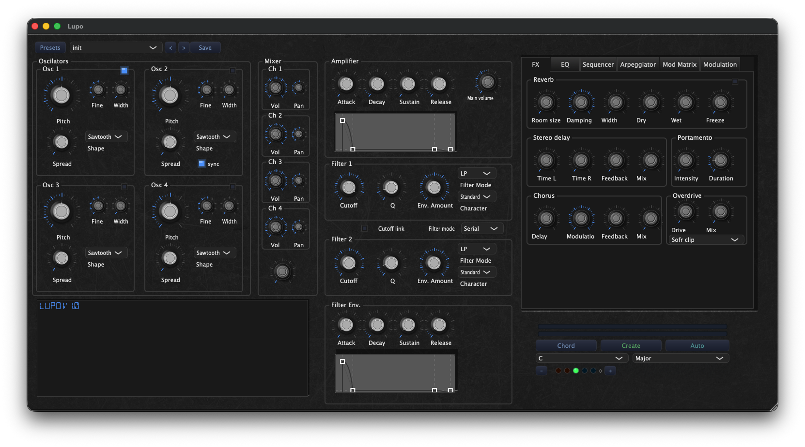

---

## B. SA-1 Drum Sampler

**SA-1** is Synthlab's drum sampler, designed for building drum kits from individual samples. It features 16 pads arranged in a 4×4 grid, each assignable to a drum hit:

| Pad | Label | Pad | Label |
|-----|-------|-----|-------|
| 01  | KICK  | 02  | SNARE |
| 03  | CLAP  | 04  | RIM   |
| 05  | CH    | 06  | OH    |
| 07  | RIDE  | 08  | CRASH |
| 09  | TOM L | 10  | TOM M |
| 11  | TOM H | 12  | COWBL |
| 13  | SHKR  | 14  | TAMB  |
| 15  | PERC  | 16  | FX    |

The waveform of the currently selected pad is displayed at the top of the window, along with metadata such as duration, sample count, sample rate, and number of channels. The MIDI note assigned to the pad is shown in the top-right corner.

Each pad can be configured individually in the right panel:

- **Volume**, **Pan**, **Pitch**, **Fine** — basic level and tuning
- **Attack**, **Release** — envelope shaping
- **Start** — sets the sample start offset
- **MASTER** — overall output volume for the sampler

Additional pad options include **Reverse** (plays the sample backwards), **Choke** (mutes other pads in the same choke group), **Load Sample** (browse for a sample file), and **Clear** (removes the assigned sample).

Kits can be saved and recalled using the **Presets** dropdown at the top.

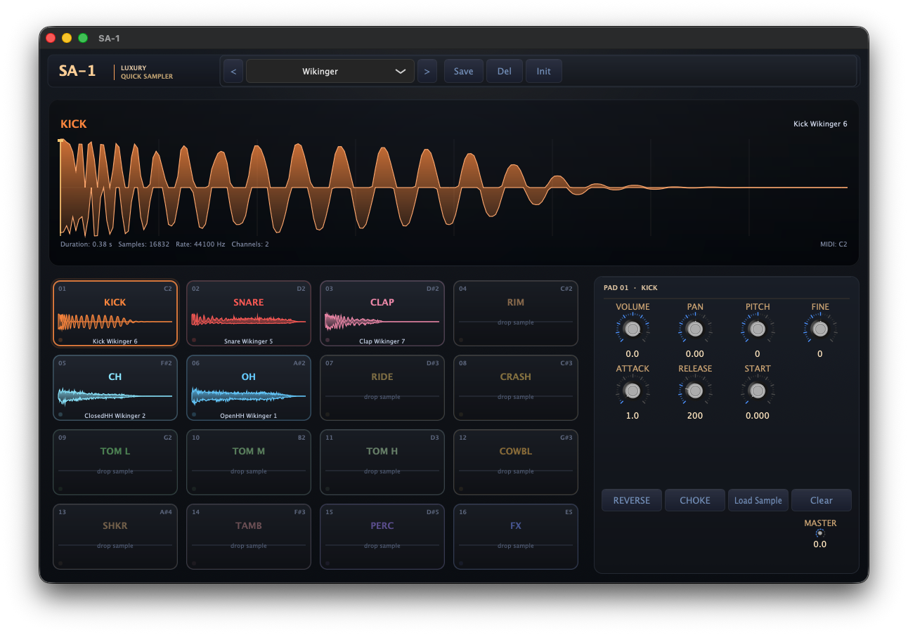

